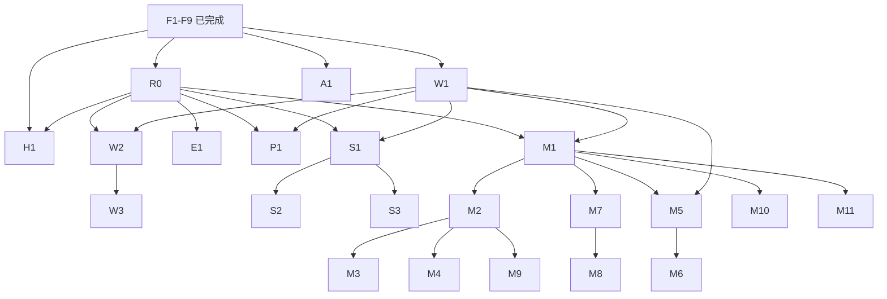

# ORI Feature Task Graph

本文件是 F10 的执行票据入口。基线为已审核的 F1–F9、已审核并 push 的 W1/W2、A1 Accordion 子集、Typography 与当前 Repository；R0 仅更新证据和文档，没有实现后续 Feature。任务 ID 表示交付顺序与验收边界，不代表新增目录、全局 abstraction 或外部操作授权。

## 基线与事实边界

- `app/_shell/routes.ts` 是导航映射唯一 owner：`/mine`、`/points`、`/stake`、`/explore`、`/about`；`/` redirect 到 `/mine`。`/explore` 已接入 E1 Core UI；`/stake` 已接入 S1 Core UI 子集，其余三个路由仍只有标题。
- F9 Header 的 Connect 在 W1 中已接入 SDK 登录与只读身份；W2 已接入 Sheet；价格与真实余额数据未接入。W1 已通过人工审核并完成 commit/push；实现与自动化验证已落地，真实连接/正确链 97 已验证；稳定 OKX profile 刷新 5/5、账户切换及实际链切换往返已由用户验收；取消重试、受控 provider 错误恢复及视觉检查通过，证据见 web3.md。不解锁资金流程。原 profile A 已归类为 Development browser profile issue / non-application blocker（见 web3.md），停止调查且不添加恢复 workaround。
- F6 提供 ORI form POST transport、错误边界和 Token price mapper；没有各 Feature 的 Query hooks。ORI 不需要后端登录、App ID 或签名。Q-13 已按已有 Backend owner 确认移出问题清单，答案见 requirements C-82 与 [api.md](./api.md#authentication--signing)，不得重新实现 Backend Auth。
- F7 是懒连接、引用计数、去重、重连 resync 的基础能力；事件 payload 仍为 unknown，Development 502 与真实事件未观察到的 Q-47 没有解决。本轮未重新探测服务。
- 开发目标为 BSC 97；生产 56 的 App、RPC、后端与 WS 配置仍有独立发布 Gate。不可把生产未知项泛化为所有开发工作的阻塞，也不可将开发通过当作生产通过。
- 视觉依据是 `ORI-AI测试`，完整 node 索引见 [figma-inventory.md](./figma-inventory.md)。R0 已重新读取登记的 Mine、Points、Explore、Wallet、Header、About 与品牌节点，事实见 [r0-evidence-audit.md](./r0-evidence-audit.md)；实现时仍须重读精确设计数据。BURY、SOL 占位、历史 live UI 不提供当前视觉标准。
- Q-03 品牌与代币资产、Q-05 字体许可条款审定/发布边界继续保留。Typography Foundation 已按用户授权接入本地 HarmonyOS Sans SC variable，全局 fallback 保留；F9 Header 仍可替换，不自行下载字体或选择最终品牌。需要新的 Token/BNB/起源资产时先过资产 Gate。

## 状态定义与总览

- **READY**：限定 Scope 的前置实现已存在，没有必须先回答的产品未知项；仍需正常评审与该票据的人工 Gate。不是自动授权登录、交易或发布。
- **PARTIALLY BLOCKED**：有明确可独立验收的准备工作，但完整 Feature 的一部分还受问题或前置票据阻塞。只能交付表中列出的安全子集，不把其余内容补成默认值。
- **BLOCKED**：核心行为/数据/交易契约或必要前置尚未完成，不启动正式端到端实现；先完成指定解锁动作。

状态是本次仓库快照；执行任何票据前重读问题清单与实际代码，再更新状态。

| ID | Slice | Status | 现在可做 / 完成前必须解锁 |
| --- | --- | --- | --- |
| R0 | 只读数据与合约证据核对（支撑票据） | READY | 限定静态审计已完成，见 R0 报告；Q-10/Q-11 未关闭，链上与新服务验证尚未执行 |
| W1 | Development 钱包连接与 identity | READY | 已完成限定行为、QA、人工审核及 commit/push；不包含余额、Sheet 或交易 |
| A1 | About accordion 与正式内容 | PARTIALLY BLOCKED | Accordion 已审核；本轮获授权恢复当前源码正文/链接，正式 /about 完整 UI 已实现，已通过人工审核；生产 Q-41/Q-30 保留 |
| W2 | Wallet Sheet Core：身份、复制/断开、BNB native balance | READY | 限定 Core 已完成、人工审核并 push。本轮增补按人工确认的 BNB native read，QA 已通过；无 Receive 或 Export 行为 |
| W3 | Wallet export / receive | BLOCKED | W2、Q-22；不能把外部钱包解释成可导出私钥 |
| H1 | Header ORI price | PARTIALLY BLOCKED | 已有 transport/mapper；旧 ORI/getPrice 来源已确认，97 数据集/价格单位与 Q-11 字段语义待确认 |
| E1 | Explore read/UI | PARTIALLY BLOCKED | 用户已批准 E1 Core UI 正式接入 /explore；四卡/三表、受控分页与中性读取状态已完成并通过人工审核；真实数据仍受 Q-27/Q-11 阻塞 |
| P1 | Points read/UI | PARTIALLY BLOCKED | 本轮已授权 Figma static demo，正式 /points 完整 UI 已实现待审核；真实规则/API 仍阻塞，不计算积分 |
| S1 | Stake read/UI | READY | 当前 UI COMPLETE；Development 97 principal read VERIFIED、已通过人工验收。额外 Info / APR / TVL / rewards / production 数据仍有独立 Gate，不阻塞当前 Development 主线 |
| S2 | Stake deposit / withdraw | READY | Development 97 Tx implementation COMPLETE；Real Tx QA = DEFERRED — TEST ORI REQUIRED，不代表真实交易通过、不阻塞主线 checkpoint。Claim / Production 56 不解锁，见 [实现边界](./stake-transaction-slice-1.md) |
| S3 | Stake yield / claim-and-deposit | BLOCKED | S1/W1；先确认 Q-26，再决定是否存在该票据的正式 Scope |
| M1 | Mine read models / owner Queries | PARTIALLY BLOCKED | Read/Data Gate 证据审计已完成并通过人工审核；97 原始读子集供 M2 使用，完整状态/Miners/单位契约仍未解锁 |
| M2 | Mine read-only UI / selection | PARTIALLY BLOCKED | 此前仅棋盘的 checkpoint 不代表整页 UI 完成；Full Mine read-only UI correction 已完成并通过人工审核，覆盖 1–6 全状态展示；业务 selection、Miners 数据、timing 与未确认资产仍 gated |
| M3 | Mine Manual transaction | READY | 限定 Manual Core COMPLETE；用户最终验收确认 Chain97真实Manual Deploy PASS；W1 + M1/M2 已确认子集，单轮一次；Manual shortcuts已按Figma启用替换输入，不依赖 M7/Reward |
| M4 | Mine Auto mining start / stop | PARTIALLY BLOCKED | M4只读Gate已执行；人工fixed/random/value/Stop已锁定；产品层closed：轮数1–9999、remaining后端直出/缺失留空；M4 Core已获人工放行实现，execution fee deduction=RUNTIME QA PENDING，待真实QA，不依赖M7 |
| M5 | Mine Rewards read/UI | READY | Development97 implementation COMPLETE；Q-25/I-30人工CLOSED，零值runtime已核对；非零真实账户及切换验收RUNTIME QA PENDING；M6仍独立 |
| M6 | Mine Rewards claim | READY | 用户以M5 Rewards Claim名称授权；Development97 implementation COMPLETE，self recipient、1确认+event/transaction验证+相关reads；REWARDS REAL CLAIM QA=RUNTIME QA PENDING，56独立Gate |
| M7 | Mine polling / freshness | READY | 当前核心owner明确后按Fast Autonomous连续推进；route-only 15/30/60s预算、M10 10s、hidden暂停/恢复/backoff/dedup已实现，不修改交易安全 |
| M8 | Mine realtime invalidation | READY | F7 signal-only adapter implementation COMPLETE；不解释payload，只invalidate当前owners。REAL SUBSCRIPTION/PAYLOAD/RESYNC QA PENDING，Q-47不伪造已解决 |
| M9 | Mine lifecycle / countdown / result | READY | 当前批准scope：verified result/动画；倒计时Human approved继续Waiting/—等backend deadline。live result transition=RUNTIME QA PENDING；无新协议enum/polling |
| M10 | Mine Miners / Winners data | READY | 人工确认当前开奖轮winners、8位BNB/ORI、backend顺序/首行You/空整区隐藏；implementation COMPLETE，nonempty runtime QA PENDING |
| M11 | Mine Origin rewards | BLOCKED | Human Confirmed：继续后置，DEFERRED — FUTURE GATE；不纳入当前Mine主线，backend + AssetManager 独立于 ORI Claim |

## Dependency Graph

箭头是交付依赖，不是允许 Feature-to-Feature import。`app` 组合 Feature；共享业务事实由真正成立的 Domain 持有，通过 Public API/显式 props 使用。不得仅按本图预建 `domains/round`、`features/*` 或 Shared UI。

R0 的对应证据必须通过才允许下游读取；图中的边不代表 R0 仅产出一份“仍未知”报告就自动解锁。M1 的公开 round 查询可先于 W1 实现，账户查询/完整验收需要 W1。M9 可以在 R0/M1 已确认的链上/轮询结果上工作，**不强依赖 M8**；若要用 WS 必须等待 M8 并重新读取 canonical 数据。Stake 与 Manual/Auto 彼此不是强依赖；先完成 Stake 仅是风险递进建议。Realtime 不依赖任一写交易成功。

## 通用执行与验收约束

所有票据均继承以下内容，表内 QA 再列出专项检查：

1. 开始时读 AGENTS、对应全局规范、Project facts、当前 owner 代码和当前 scripts。没有明确 Scope/Gate 的 Unknown 保持 Unknown；部分准备完成不等于 Feature COMPLETE。
2. 业务 API/合约 read 的 server state 在 TanStack Query；Query identity 含实际影响结果的 chain/account/contract/round/page/filter 等维度。账户、链和轮次变化时取消或隔离旧请求，不展示前一个身份的数据；地址按 EVM 语义比较。
3. Privy/Wagmi 持有钱包事实；不复制到 Zustand。金额/原始整数用 string/bigint，按真实 decimals/单位转换。不能用 `parseFloat`、浮点乘除或不安全 JSON number ID 做资金计算与去重。
4. API 必须经现有 ORI transport 和 DTO boundary；错误不泄露 backend body/trace。Contract/runtime mismatch 分字段记录，不悄悄任选一个版本。测试 fixture 可以描述已知输入，不能进入生产数据路径或冒充真实余额/价格。
5. 每个会改变运行行为的票据至少运行当前 `env:check`、typecheck、lint、format:check、test、build、`git diff --check`，并完成相应浏览器/真实环境验证；具体矩阵遵守 `docs/qa.md`。不写纯 CSS snapshot，不为每个静态节点加形式测试。
6. UI 验证覆盖 375px、常见手机宽度、PC 500px 居中；检查键盘、focus、长地址/长数字、内容滚动与 safe-area。字体消费全局 Typography Foundation，不在 Feature 注册；Q-05 的许可发布边界继续保留。Q-30 未解决时不扩建 locale routing 或自行决定新默认语言，正式 en/zh 资源与产品审定单独过 Gate。
7. 每个写流程在实现前定义：simulation、签名/拒签、广播、receipt/revert、replacement/cancel、超时、后端 reconciliation、完成后的 owner invalidation。txHash 不是业务成功；捕获并冻结 account/chain/contract/round/operation 上下文，切换上下文不能把旧交易结果归到新账户。
8. 模拟/单元测试不授权真实交易。真实测试必须有用户针对该类操作与目标环境的明确授权；确认 BSC 97、测试合约、测试账户、额度与收款地址。不得顺手调用 `resetRound`、checkpoint、执行器、approve 或 transfer 作为 smoke。生产写与 deploy 均另行授权。

## Feature Tickets

### W1 — Development Wallet connection / identity

| Field | Ticket |
| --- | --- |
| Goal | 接入已存在的 F5 wallet runtime，使 F9 Header Connect 能启动 SDK 钱包连接，并显示当前外部钱包身份；不把完整 Wallet 混成一票 |
| Route | 全局 Header，所有现有主路由；不新增 `/wallet` |
| Owner / Dependencies | `features/wallet` 的最小连接/身份边界，由 `app/_shell` 组合；依赖 F5/F9，不重建 Provider/connector |
| Source of Truth | requirements C-04/C-08；web3.md Wallet model / F5；当前 capability、Privy config、providers |
| API dependencies | 无；不做 Backend Auth、不发送 App ID/签名 |
| Web3 dependencies | Privy ready/authenticated/wallet 与 Wagmi account/chain 的真实状态；Registry target 97；本票据无余额/合约 read/write |
| Realtime dependencies | 无 |
| UI/Figma dependencies | Header `2003:190`、`2003:990`、钱包入口 `2003:999`；仅重读并适配这些节点；SDK 自身 modal 不自建皮肤 |
| Open Questions / Blockers | Development Scope READY；Q-04 Production 与 Origins 不在本票据内。使用仓库已确认的 localhost:3000 或 :5199，不默认 :5173 被授权；若该连接仍失败，先报告 auth/origin 证据，不能修改外部配置绕过 |
| Acceptance Criteria | capability 不可用时不调用未挂载 Provider 的 hooks；未 ready 时不误启动登录；取消登录可重试；刷新与账户/链变化显示真实身份，不保存地址副本。连接后先显示只读身份状态，完整地址按钮/Sheet 行为交 W2，不添加无效 click handler。SDK disconnect 能力通过独立测试验证，产品断开入口由 W2 承载；通过 G-W |
| QA | 通用 QA；mock 覆盖 capability/ready/cancel/account/chain 切换；人工通过已授权钱包在确认的 Dev Origin 连接/刷新/断开；不做交易或资金签名。若 SDK 登录确需消息签名，先核对官方 SDK 流程和消息用途，由用户确认钱包提示，不自动签名 |
| Non-goals | Sheet、复制反馈、余额、导出/接收、网络切换 UX、资产转移、Production Privy 配置、通用钱包巨型 store |

### A1 — About accordion / approved content

| Field | Ticket |
| --- | --- |
| Goal / Route | `/about` 完整页面；当前 Figma 五项结构，复用已审核 AboutAccordion |
| Owner / Dependencies | features/about；F8/F9、Typography、现有 Accordion；不依赖钱包 |
| Source of Truth | 用户本轮限定例外 → 当前 ORI-AI测试视觉 → 当前旧源码实际引用正文/链接；仅恢复 copy，不继承旧 UI/额外栏目 |
| API / Web3 / Realtime | 均无调用；文案比例不成为交易参数或合约事实 |
| UI/Figma dependencies | 2235 / 2359 完整 frames、直接子节点；Intro/Mining 展开仅是状态证据，runtime 默认全部 collapsed、单项展开 |
| Open Questions / Blockers | 当前工程演示 UI 无正文 Gate；Q-41 文案/合约口径与 Q-30 生产语言审定继续 OPEN，不阻塞本次 UI |
| Acceptance Criteria | 五项完整、恢复对应正文/链接、长文可浏览、安全富文本、键盘/焦点、375/500；本轮已通过人工审核 |
| QA | 完整七项；每项展开、Enter/Space、单项切换、长文滚动、双语、Bottom Nav spacing |
| Non-goals | 旧布局、额外起源/精炼页面栏目、CMS、链上费率认证、交易 |

### W2 — Wallet Sheet core

| Field | Ticket |
| --- | --- |
| Goal | Header connected identity 打开/关闭/重开 Sheet；当前身份、地址复制/断开、BNB native balance；external 钱包不显示 Export / Receive |
| Route | 全局 overlay，无新 Route |
| Owner / Dependencies | 现有 `features/wallet`，依赖 W1/F8/F9；开关与交互反馈为 React local state，不新增 Provider/store/dependency |
| Source of Truth | User Confirmed W2 Human Gate → 当前 Figma；C-22/C-83–C-85。旧 Wallet 不作为新版需求来源 |
| API dependencies | 无 Backend API；余额使用 environment-selected BSC RPC 的 eth_getBalance，不读取 backend mining fund |
| Web3 dependencies | 直接消费 W1 的 Privy/Wagmi identity/chain；复制当前地址、Privy logout；Wagmi native balance query，不读取 ERC20/ORE contract |
| Realtime dependencies | 无 |
| UI/Figma dependencies | `2003:2487/2490`：H5 bottom sheet，top radius 16；PC center Modal（当前用户修正），内容面板 PC 400px 居中，backdrop 全屏；四个局部原始 SVG；不画系统 Home Indicator |
| Open Questions / Blockers | 限定 Scope READY：Q-21 已解决；BNB native owner 已由用户确认（Q-22）；Export / Receive 已确认仅 embedded wallet，external 隐藏，不阻塞 unavailable visual slot / 不可用控件；字体 fallback、Q-03 最终品牌不升级 |
| Acceptance Criteria | Header open/close/reopen；刷新后可打开；账户/链切换即时使用 SDK 新事实，无旧地址/余额；BNB 余额正确读取；不可用显示 — BNB，不用48.60；external Wallet 不渲染 Export / Receive；不为两按钮创建 embedded wallet；复制失败可重试，logout 失败不伪装成功；ESC、焦点隔离/恢复、backdrop、safe-area、375/500 无 overflow |
| QA | 全部项目 QA；真实 Header/Sheet、刷新、账户/链往返；keyboard/close/copy/disconnect；375px 与 PC 500 居中，mock 与真实证据分开报告 |
| Non-goals | Receive/QR/fundWallet、真实 Export/私钥/助记词、多资产、旧 mining fund、Backend session、交易或其他 Feature |

### W3 — Export / Receive decision and implementation

| Field | Ticket |
| --- | --- |
| Goal | 仅在产品明确语义后实现 Wallet 剩余操作；若产品决定不支持，记录决定并取消本票据 |
| Route | W2 Sheet 内 |
| Owner / Dependencies | Wallet；W2、Q-22 先过 G-P/G-W |
| Source of Truth | Q-22、外部钱包事实、产品确认的操作/目标资产/网络 |
| API dependencies | 当前无确认端点；需要新端点须先锁 Contract |
| Web3 dependencies | 当前没有获准 write；receive 若仅展示地址也不能演变成发送资产。外部钱包不提供应用可导出的私钥 |
| Realtime dependencies | 无 |
| UI/Figma dependencies | Wallet `2003:2526` 等操作位；缺少详细流程设计，确认后重读/补设计 |
| Open Questions / Blockers | BLOCKED：当前 external-only 明确隐藏两入口；未来 embedded 模型尚未批准，ORE 资产仍未知 |
| Acceptance Criteria | 语义、支持钱包、隐私/失败路径经人工签收；实现与确认操作完全对应，不接触或传递私钥；若产生交易另过 G-T |
| QA | 通用 QA 加批准流程的专项用例；真实资金操作不作为普通 smoke |
| Non-goals | 从按钮名称推断 transfer、创建 embedded wallet 或拼接未确认的二维码/支付协议 |

### H1 — Header price read/UI

| Field | Ticket |
| --- | --- |
| Goal | 给 F9 价格位接入确认的 ORI 价格，移除无数据时的歧义，保持 Header 尺寸 |
| Route | 全局 Header |
| Owner / Dependencies | `app/_shell` 组合、现有 `domains/token` read/model；F6/F9；R0 对应端点核对 |
| Source of Truth | C-21、Q-23、api.md Numeric fields 与现有 asset-price mapper |
| API dependencies | 旧 Header 来源已确认是 `query/chain_asset_config`；见 R0，不能改用 `activity/origin_info`。新版 97 数据集与 symbol/address/isInner 多行/缺价匹配语义仍须 G-D |
| Web3 dependencies | 使用 Registry 的 ORI 资产身份；本票据不补 BSC 97 WBNB 地址，不把缺失 BNB 美元价变成 0 |
| Realtime dependencies | 无；刷新策略由 price Query owner 定义 |
| UI/Figma dependencies | Header `2003:195` 价格位；空/加载/失败显示需 G-V |
| Open Questions / Blockers | PARTIALLY BLOCKED：mapper 已存在；Q-23、Q-11 price 类型/单位/inner 语义与异常反馈未确认 |
| Acceptance Criteria | G-D/G-P/G-V 通过；只显示目标资产的真实价格，十进制精度安全；无数据不显示设计示例 $268.32，也不挤压连接入口 |
| QA | 通用 QA；资产/address 匹配、多行/缺价、number/string DTO、长价格布局 |
| Non-goals | 通用行情系统、实时价格 WS、Stake APR 推导 |

### E1 — Explore read/UI

| Field | Ticket |
| --- | --- |
| Goal | E1 Core UI：当前四卡、Mining/Motherlodes/Buybacks 三表与受控分页，正式接入 /explore；完整票据后续接真实数据 |
| Route | `/explore` |
| Owner / Dependencies | `features/explore`；F6/F9；R0 的对应后端证据通过；公开数据不要求钱包登录 |
| Source of Truth | C-60、Q-27、api-reference 正式 Contract 与 api.md Differences；旧调用只作证据 |
| API dependencies | `explore`、`reset_event/list`（motherlode filter）、`bury_event/list` / `activity/bury_point_events` 的选用与 type 必须由 scope 对照锁定；page/page_size、list/total、时间/金额单位及稳定行 identity 明确 |
| Web3 dependencies | 无默认合约调用；链维度用于隔离数据集，链上 explorer URL 来自 Registry |
| Realtime dependencies | 无必需订阅；不要复制 Mine 事件接线 |
| UI/Figma dependencies | `2003:2534`、`2003:2659` 等统计卡、`2003:2883` 等分页；375px 表格局部滚动 |
| Open Questions / Blockers | PARTIALLY BLOCKED：Core UI 子集已获用户授权；无 metadata 不显示页码，prev/next 禁用，统计 —、三表 Data unavailable；中性 loading/empty/error/populated 接受 typed display props，不接 API。完整数据接入仍需 Q-27 新版数据范围与回购类型映射、Q-11 缺 circulating_supply/number-string 差异、不安全 number ID、加载/空/错误与资产待定；不能先决定隐藏字段 |
| Acceptance Criteria | G-P/G-D/G-V 后完成；不虚构缺失统计；分页/filter Query identity 完整；大整数行 ID 不用已丢精度值；表格滚动不造成整页 overflow |
| QA | 通用 QA；DTO 缺字段/超大 ID、分页边界与过滤、错误/无记录、375/500 长表 |
| Non-goals | 起源/ORI 游戏页面、swap、交易、用相似 Table 提前造通用系统 |

### P1 — Points UI / future reads

| Field | Ticket |
| --- | --- |
| Goal / Route | `/points` 完整 Figma UI；本轮为明确标记的 static demo，真实读仍 PARTIALLY BLOCKED |
| Owner / Dependencies | features/points 的 typed display model、demo data 与页面；F8/F9、Typography、locale；无钱包依赖 |
| Source of Truth | 用户本轮允许 Figma sample 作为集中 demo fixture；2003:2101 全页面/全部直接子节点 |
| API dependencies | 本轮无调用。points/list、points/user wrapper 没有旧页面 consumer；真实契约/500 留 Q-11 |
| Web3 / Realtime dependencies | 本轮无调用、不计算积分、不创建 store |
| UI/Figma dependencies | My Points 2113、40px icon 2117、Records/规则 2121–2122、四列表头 2159–2170、六行 2123–2158；没有额外 tabs/modal/pagination 状态 |
| Open Questions / Blockers | Q-01/Q-20/Q-11 继续阻塞生产积分规则与真实数据，不阻塞当前静态演示 UI；原 Figma SOL 占位按已确认 BSC 事实替换为 BNB 标签，金额仍为 fixture |
| Acceptance Criteria | 完整页面可浏览，visible demo 标记，数据集中可替换，安全 string 展示，375/500/双语；本轮已通过人工审核 |
| QA | 完整七项；四列/六行、精度安全、demo 标记、语义表格、字体、溢出与 Bottom Nav |
| Non-goals | 真实积分、API wiring、公式、旧起源/游戏记录/claim 功能、虚构分页 |

### S1 — Stake read/UI

| Field | Ticket |
| --- | --- |
| Goal | Core UI 子集交付当前 Figma Deposit/Withdraw 展示与 Summary，正式接入 /stake；当前增量只接已验证的 Development 97 ORI available / user staked / total staked；资金入口不可执行，其他数据按 Gate 接入 |
| Route | `/stake`；Withdraw 是页内状态，无新 Route |
| Owner / Dependencies | `features/stake`；W1/F9；R0 的 ABI/单位/端点证据；公共 Summary 可先于账户读取 |
| Source of Truth | C-50–C-53、web3.md Stake、api-reference summary、Q-26 |
| API dependencies | `summary` → staking_annual_yield；TVL/total deposit 的来源、价格与显示单位必须逐项核对，不能从 APR 推造其它字段 |
| Web3 dependencies | Registry OreProtocolView `getStakeInfo` / `getTreasuryState`、ORI `balanceOf`；97 的 decimals=18 已 runtime 确认，56 未验证；不 approve、不 deposit/withdraw |
| Realtime dependencies | 无订阅或 interval polling；账户/链 key 与 Query invalidation/手动 Refresh 由 Stake read owner 负责 |
| UI/Figma dependencies | `2003:1949`、`2003:1961`、`2003:2078`；AmountInput/percentage 的共享只在真实需求出现时评估 |
| Open Questions / Blockers | 当前批准的 UI COMPLETE、97 三条 principal read VERIFIED（账户/错链往返/断开/刷新恢复，无旧账户缓存残留）；无 API，不推导 APR/TVL/rewards。S2 97 transaction implementation COMPLETE，真实交易 QA 因测试 ORI 缺失暂缓、不阻塞主线。Q-10、Q-26、Q-24、Q-16、Q-03 其他范围继续 OPEN；不能扩大至 56 或收益 |
| Acceptance Criteria | G-D/G-P/G-V；显示真实 ORI/decimals，百分比 bigint 安全；未知收益字段不补零；表单不产生写调用；账户/链切换不串数据 |
| QA | 通用 QA；余额/单位/精度、Summary DTO、Tab 键盘语义、断网/身份切换、长数值 |
| Non-goals | 质押资金操作、yield 领取、收益率估算算法或跨 Feature Query deep import |

### S2 — Stake deposit / withdraw

| Field | Ticket |
| --- | --- |
| Goal | 在 S1 基础上完成独立可审查的 ORI 存入与取出流程 |
| Route | `/stake` |
| Owner / Dependencies | Stake workflow；S1/W1；相关 R0 证据与 G-T 先通过 |
| Source of Truth | C-50/C-51、Contract Registry ABI、docs/web3.md transaction contract |
| API dependencies | 通常无写 API；确认后刷新 S1 owner Queries，若需后端索引必须锁定 reconciliation endpoint |
| Web3 dependencies | ORI allowance / approve(OreProtocol) → approval receipt → depositStake；withdrawStake(amount,to)。先 simulation、上下文冻结与资产/收款地址校验 |
| Realtime dependencies | 无；不得等待 Mine WS 才刷新账户数据 |
| UI/Figma dependencies | S1 表单加签名/pending/reverted/cancel/timeout/完成状态；Q-12 无设计时不得自行造全局 toast 系统 |
| Open Questions / Blockers | Development 97 implementation COMPLETE：人工已签收 runtime path、exact approval、self recipient、1 confirmation 与 receipt→reads 完成契约。Real Tx QA = DEFERRED — TEST ORI REQUIRED（ORI 为 0），用户批准 checkpoint 且不阻塞主线；不声称真实交易已验证。未证实的 runtime 限制仍由每次 simulation 防护，不能推广到 Claim 或 Production 56。详见 [Slice 1](./stake-transaction-slice-1.md) |
| Acceptance Criteria | 每个操作明确状态、确认阈值与失败语义；approve 后重读 allowance，拒签/失败不进入 deposit；切链/切账户使未签操作失效，旧 receipt 不更新新账户；G-T/G-W/G-V |
| QA | 通用 QA；模拟所有失败/替换/超时与 approval 分阶段路径；真实 BSC 97 approve/deposit/withdraw 仅在明确授权后验证并报告余额变化 |
| Non-goals | yield、自动复投、主网测试、一次批准全部未来额度 |

### S3 — Stake yield / claim-and-deposit

| Field | Ticket |
| --- | --- |
| Goal | 先确定新版是否支持质押收益操作；批准后按每种资金流程再单独验收 |
| Route | `/stake` |
| Owner / Dependencies | Stake；S1/W1，复存若需要 deposit 则依赖 S2；Q-26/G-P 先通过 |
| Source of Truth | C-53、Q-26、已核对 ABI；不能从旧 Claim and deposit 文案推断原子流程 |
| API dependencies | 复用已确认的 Stake read/reconciliation；无新假端点 |
| Web3 dependencies | 候选 claimStakeYield(to)；claim-and-deposit 的调用组合、失败补偿、是否需多笔交易尚未确认 |
| Realtime dependencies | 无 |
| UI/Figma dependencies | 新版没有对应完整 UI，需设计补充及 Q-12 状态 |
| Open Questions / Blockers | BLOCKED：Q-26、Q-10、Q-12；先锁范围再决定拆成 claim 与复存子票据 |
| Acceptance Criteria | 人工确认保留/取消；保留时每笔资金调用及完成契约清楚，G-T/G-V 通过；不存在“第一笔成功即整体成功” |
| QA | 通用 QA；多步中断、拒签/部分成功、上下文切换；真实交易另授权 |
| Non-goals | 预建自动复投机器人、无确认的批处理交易 |

### M1 — Mine read models / owner Queries

| Field | Ticket |
| --- | --- |
| Goal | 为 round、square、miner、当前账户部署建立字段级数据来源与稳定 Query owner，先解决可见数据可信度 |
| Route | `/mine` 的数据边界；本票据不改交易入口 |
| Owner / Dependencies | Mining read owner；F6、Registry/F5、R0；账户读接 W1。是否成立 `domains/round` 按真正复用决定，不按票据预创建 |
| Source of Truth | C-30/C-43/C-45/C-49、api.md、web3.md View methods、正式 API Contract |
| API dependencies | latest/events、reset_event/round、两个 round endpoints；M1 新 runtime 已确认 flat latest、started 对象与 winners list envelope，正式 Contract 仍冲突；旧 `round` 未登记。Miners 语义/排序/金额与 lossless ID 仍需 G-D |
| Web3 dependencies | M1 已在 97 验证 board/current/gameState/roundData/squareStats/treasury 与空账户读；getRoundData 包含 minersPerSquare[25]，getSquareParticipants 两格样本与统计一致。原始 read 兼容性不等于当前/下一轮和 enum 产品状态已确认；56 未验证 |
| Realtime dependencies | 无；Query 不依赖 WS 才可工作 |
| UI/Figma dependencies | `2003:485` 等 Metrics、`2003:508` Miners 的字段需求；不把 Figma 示例数字做默认数据 |
| Open Questions / Blockers | PARTIALLY BLOCKED：[M1 Read/Data Gate](./mine-read-data-gate.md) 证据审计已完成并通过人工审核，完整 Gate 仍 BLOCKED；已批准原始读由 M2 public snapshot Query 持有，其他 M1 read models/mapper 未实现。97 原始字段有可用来源；已 fulfilled 的存储轮仍 canDeploy、下一轮未初始化，其呈现语义/状态映射未签收；Miners 投注者/获奖者与金额/排序、Q-18/Q-19/Q-31、API DTO/unsafe ID 仍需人工 Gate |
| Acceptance Criteria | 每个字段有 canonical 来源、单位、identity 和冲突/缺失处理；public/account Queries 分离、round 切换原子隔离旧结果；缺失字段不补零；G-D 签收后才宣布 read model 完成 |
| QA | 通用 QA；DTO/精度/地址大小写/25 项长度、旧 round 响应迟到、账户/链切换、API/链上差异用例 |
| Non-goals | 投注/领奖、巨型 roundStore、把全部旧接口搬进 Shared、擅自选择后端替代 endpoint |

### M2 — Mine read-only UI / selection

| Field | Ticket |
| --- | --- |
| Goal | 当前用户授权 M2 Full Mine UI correction：正式 /mine 完整 Metrics/board/Manual–Auto/结果列表结构，全部 1–6 的局部状态视觉；仅已确认 97 public read，不实现 selection interaction、资金动作或未签收业务映射 |
| Route | `/mine` |
| Owner / Dependencies | `features/mine` 持有页面、cells、display 和 public Query；app/mine 组合 W1 的错链事实；F8/F9、Registry、M1 已确认的 97 read 子集 |
| Source of Truth | C-43/C-45/C-49、ui-behavior Mine；金额显示仅消费 M1 model |
| API dependencies | 本子集无 API 请求；不接 /ori/round、winners/participants list；后续字段仍等 G-D |
| Web3 dependencies | Registry/Viem：board、getCurrentRoundInfo、getRoundData 固定同一 latest blockTag，验证 identity/total/25 项，保留 bigint；仅 Development 97，不启动 simulation/write |
| Realtime dependencies | 初期不直接订阅；M7 负责新鲜度，M8 后续接入 |
| UI/Figma dependencies | `2003:182`、`2003:629`、`2003:1009`、`2003:1038`；状态/图标精确重读，真实 BNB/ORI/起源资产 |
| Open Questions / Blockers | PARTIALLY BLOCKED：用户本轮指出旧交付只覆盖棋盘，不能认定整页完成；Full Mine read-only UI correction 已完成并通过人工审核，完整 [state inventory](./mine-page-state-inventory.md) 覆盖七个 frame。stored round 不推导 +1；已结束/fulfilled 仅 Waiting · Read-only；不显示 winning visual。Q-18/Q-19 仅有 isolated presentation 测试，不开放 runtime 选择；Miners、精确 countdown、Motherlode、个人部署、USD/reward/起源继续 unavailable；完整 M2 与 M1 Gate 未解锁 |
| Acceptance Criteria | 当前子集：公共 Query key 仅 chain/deployments，无 account；错链隐藏缓存，错误不冒充零，refresh/invalidation 可恢复；25 格 index→#1–#25、BNB18 与 bigint count 正确；正式 route 无 cell/button selection 或资金入口。完整 M2 的交互与 Miners 另过 G-P/G-D/G-V；旧清空描述不是产品事实 |
| QA | 通用 QA；mask/选择规则测试、所有已确认状态 fixture、账户/round 切换、375/500 对照 |
| Non-goals | Manual/Auto 表单资金动作、完整动画、设计外 trade-to-mine 标签或起源 swap |

### M3 — Mine Manual transaction

| Field | Ticket |
| --- | --- |
| Goal | 每账户每个实际 operation round 最多一次成功 Manual Deploy；首笔可多格同金额，完成前置校验与确认后的数据对账；禁止同轮异格追加 |
| Route | `/mine` Manual 面板 |
| Owner / Dependencies | Mining Manual workflow；W1 与 M1/M2 已确认 round/board/account 读；不依赖 Stake、M7 或未来 Rewards |
| Source of Truth | 用户规则 → 当前 Figma → 已审核 docs → Mine Historical Functional Baseline → runtime/ABI 可行性；详见 [正式需求对齐](./mine-requirements-reconciliation.md) |
| API dependencies | Manual Core 无 API 前置；公共与个人 canonical reads 归 Chain 97 Queries；不把旧 /round 索引作为成功条件 |
| Web3 dependencies | deployManual(mask,amountPerSquare)，value 精确等于 amountPerSquare × selected count；无需 ERC20 approve；读 canDeploy/当前部署/automation conflict，处理 checkpoint 错误 |
| Realtime dependencies | 不依赖 M7/M8；fresh preflight 与 receipt 后局部 refetch 是本 transaction owner 的正确性职责 |
| UI/Figma dependencies | 全七稿 inventory + `2003:1715` 四态；沿用已签收 signature→receipt→event→refresh 语义，不继承旧 hash 即成功 |
| Open Questions / Blockers | COMPLETE（用户最终人工验收：Chain97真实Manual Deploy PASS）：单轮一次、18位、mask/value、operationRound、receipt/event/refresh 已签收。Manual shortcuts按Figma启用替换输入、不新增全选；成功后保留 deployed visual，selection/amount可编辑；仅最终action disabled并显示“本轮已部署”，无独立提示。Q-16 Manual快捷值/替换行为已签收；完整时钟/Rewards/Miners不阻塞Core；MustCheckpoint 只提示刷新。见 [需求对齐](./mine-requirements-reconciliation.md) 与 [实现计划](./mine-manual-implementation-plan.md) |
| Acceptance Criteria | G-P/G-T/G-V；25 位 mask 合法、总额 bigint；本轮账户 participation/total/mask 任一证明已部署，所有第二次 Manual submit 均 fail closed，与新 mask 是否重叠无关；新轮独立 Query 不沿用旧轮锁；拒签与链上 revert 不混淆；按 receipt + 1 confirmation + matching DeployEvent 得到 operationRound，成功刷新原账户/round reads；确认后验证/刷新失败只 retry、不 resend。见 [修正计划](./mine-manual-implementation-plan.md) |
| QA | 通用 QA；全部/单格/非法 mask、精度/余额边界、round 在签名前后切换、重复点击、replacement/timeout；真实部署仅 BSC 97 单独授权 |
| Non-goals | Auto、Rewards、前端代替 bot 结算、设置无限重试或主网 smoke |

### M4 — Mine Auto mining start / stop

| Field | Ticket |
| --- | --- |
| Goal | 在明确预付公式与执行器事实后实现多轮自动部署、运行状态和停止退款 |
| Route | `/mine` Auto 与 Autominer 状态，无新 Route |
| Owner / Dependencies | Mining Automation workflow；W1/M1/M2 + Auto-specific Gate；不把 Manual 成功当作技术前置，建议在 M3 审核后推进以降低风险 |
| Source of Truth | 当前M4人工规则、C-31/C-33/C-34/C-47/C-48、[M4 Gate](./mine-auto-transaction-gate.md)、当前Figma；历史材料不替代runtime验证 |
| API dependencies | P.getAutomation为active/config/balance canonical owner；automation/user仅enrichment，HTTP200/null不证明populated契约，remaining display owner已签收为extend_data.round_remaining、缺失留空，禁止balance/fee推导；API样本验证限制不重开产品Gate |
| Web3 dependencies | 当前97 register/getter/stop/refund虚拟验证；value=(perSquare×count+fee)×rounds、余额另需gas；stop recipient=self、退款由合约。执行器非前端；当前执行扣费版本补证仍缺 |
| Realtime dependencies | preflight/receipt 后局部刷新由 Auto owner 负责；M7/M8 后置，不能用事件推算余额/剩余轮数 |
| UI/Figma dependencies | `2003:1832`、`2003:1890`、`2003:1667`、运行中 `2003:1413`；产品输入1–9999、最小执行费说明已签；remaining后端直出/缺失留空 |
| Open Questions / Blockers | Development Core已Human approved放行；完整execution QA仍PENDING：产品金额/fixed/random/显示fee/self Stop均已签收；当前execution扣费只有历史context、implementation关联未证；产品层Human Decisions全部closed：1–9999为前端限制，remaining直接显示后端字段且缺失留空。七/六字段投影已验证、backend非空未证不改变产品owner。runtime path technically unresolved由人工接受，不阻塞Development Core；[实现/真实QA边界](./mine-auto-core-implementation.md)，不声称成功execution扣费已验证 |
| Acceptance Criteria | G-P/G-T/G-V；精确预付拆分、随机/指定mask一致；Manual已部署不阻塞Auto Register，active Auto整体替换Trade Card；start receipt 不等于已执行下一轮；stop 后按批准的链上状态/退款对账，不依据旧 UI 直接显示成功 |
| QA | 通用 QA；轮数/费用/余额/随机位图、执行器延迟/缺席、停止失败与退款地址、账户/链/round 切换；start/stop 真实调用分项授权 |
| Non-goals | 自建 executeAutomation bot、后台常驻任务、从前端执行 resetRound |

### M5 — Mine Rewards read/UI

| Field | Ticket |
| --- | --- |
| Goal | 按人工确认BNB/未精炼ORI/已精炼ORI映射显示真实raw奖励；全零隐藏，非零入口按资产条件显隐，不推算净额/到期 |
| Route | `/mine` Rewards 区 |
| Owner / Dependencies | Mining Rewards read/UI；W1/M1，R0 对应 ABI；不要求 M3/M4 已发出交易（可以有历史账户数据） |
| Source of Truth | C-40–C-42、getUserRewards 返回字段与 Q-25/Q-42 |
| API dependencies | 非必需；若起源奖励需额外 API/AssetManager，先明确边界与 Q-01，不能塞入同一 Rewards model |
| Web3 dependencies | getUserRewards(miner)、ORI decimals；不能把 ethAmount 命名成 ETH 或把 ORI 显示成 ORE/BURY |
| Realtime dependencies | M7 刷新已有 owner Query；M8 可后接 |
| UI/Figma dependencies | frame1413 / card1683 / rows1684–1714；Q-25/I-30人工已确认；BNB图标为人工资产映射替换，其余当前Figma属性保留 |
| Open Questions / Blockers | M5 Development97 implementation COMPLETE，read/UI无产品blocker。详见 [M5实现](./mine-rewards-implementation.md)；非零真实账户/切换RUNTIME QA PENDING。后续97 Claim/currentAccount与完成策略已签收并实现，真实Claim QA PENDING；不推算税/时限，56仍Release Gate |
| Acceptance Criteria | G-D/G-P/G-V；金额独立建模、无奖励和读取失败分开；未知到期时间不推造 countdown；本票据 Claim 不可执行 |
| QA | 通用 QA；三类金额/零/过期/读取失败、地址切换、长数值与卡片显示条件 |
| Non-goals | M6、AssetManager 的未确认 claim/claim_bnb、起源奖励资金流程 |

### M6 — Mine Rewards claim

| Field | Ticket |
| --- | --- |
| Goal | Development97领取→claimAll(currentAccount) / 仅领取BNB→claimEth(currentAccount)；不推算净额/税/时限；按fresh simulation与合约实际结果处理 |
| Route | `/mine` Rewards 区 |
| Owner / Dependencies | Mining claim workflow；W1/M5，已核对的协议证据 |
| Source of Truth | C-40/C-41/C-42、claimAll(to)/claimEth(to)、对应错误与全局 transaction contract |
| API dependencies | 明确是否有业务索引完成条件；无此依赖时不可发明 claim API |
| Web3 dependencies | self recipient人工签收；Registry P，fresh reward+simulation，1确认及交易/event验证后refresh rewards/native balance（all另ORI）；无approve或前端费用推导 |
| Realtime dependencies | M8 非前置；receipt 后主动刷新 M5/Wallet 的真实受影响 owner，不广播全站 invalidation |
| UI/Figma dependencies | Rewards Claim / Claim only 文案与 Q-12 交易状态补充 |
| Open Questions / Blockers | Development97 implementation COMPLETE；人工已批准self recipient/Claim映射/receipt+相关reads成功策略，不另开Gate。[Claim实现](./mine-claim-implementation.md)；真实Claim QA PENDING不阻塞主线。Q-42未知时长不推算，若合约要求checkpoint则失败，不自动追加write；56仍Release Gate |
| Acceptance Criteria | G-P/G-T/G-V；正确领取类别和收款地址，NothingToClaim/ClaimWindowPassed 明确；receipt 与可见余额对账按完成契约区分，旧账户结果不污染新上下文 |
| QA | 通用 QA；全领/仅 BNB、无奖励/过期/拒签/revert/replacement、税与精度；真实 claim 操作另行授权 |
| Non-goals | 起源 claim、expired reward sweep、替他人领取、质押收益领取 |

### M7 — Mine polling / freshness

| Field | Ticket |
| --- | --- |
| Goal | 使 Mine 在 WS 不可用时也能持续获得可信 read state；新鲜度规则跟数据 owner 对齐 |
| Route | `/mine` 生命周期；不在全局 Header 常驻轮询 |
| Owner / Dependencies | M1 Query owner；如 M5/Automation owner 已存在，分别按 Public API 接入；不要求写交易或 M8 |
| Source of Truth | api.md polling 与 TanStack Query integration、M1 字段来源；旧 1s/3s/4s/10s 只是历史证据 |
| API dependencies | 对已锁定端点定义间隔、后台/聚焦/重连、失败退避及取消策略；未知 round 端点不得进入调度 |
| Web3 dependencies | M1 合约读 Query；明确 RPC 负载与 round/账户/链变化的启停条件 |
| Realtime dependencies | 不依赖连接成功；disabled/unavailable 时 polling 不停止 |
| UI/Figma dependencies | 无新增组件；stale/error 对应已批准的 UI 状态 |
| Open Questions / Blockers | 现有owner明确，按Fast Autonomous工程自治设定有界Development预算，implementation COMPLETE；[M7/M8实现](./mine-freshness-implementation.md)。无未知round API或协议时钟；Production56不扩大 |
| Acceptance Criteria | G-D；逐数据 owner 写明 freshness budget 与执行策略，离页无泄漏，聚焦/重连刷新，旧请求不覆盖新 round；不复制全局 timer/server state |
| QA | 通用 QA；fake timers/请求计数验证启停与退避、后台恢复、离页、账户/链/round 切换；真实只读压力以批准的频率验证 |
| Non-goals | 把旧轮询间隔固化为默认、WS 实现、定时后台执行交易 |

### M8 — Mine realtime invalidation

| Field | Ticket |
| --- | --- |
| Goal | 在 M7 之上给轮次开始/开奖增加及时刷新信号，并验证断线补偿 |
| Route | `/mine`；最后一个消费者离开即释放 |
| Owner / Dependencies | Mining/实际 round Query owner；M1/M7 与 F7，不重建 Pusher client |
| Source of Truth | api.md Realtime、ori-realtime-events.ts、真实 backend payload Contract 与 smoke |
| API dependencies | 事件后重新请求 M1/已存在的 Automation/Rewards owner Queries；不以 payload 当 canonical server state |
| Web3 dependencies | 只 invalidate 已确认相关 read；无 write |
| Realtime dependencies | round.new_round / round.data.started；round.reset / round.data.reset；F7 event/resync；schema 确认后在事件定义 parse 边界校验 |
| UI/Figma dependencies | 无新 UI；动画另由 M9 接管，不与 transport 合并 |
| Open Questions / Blockers | signal-only adapter implementation COMPLETE；F7已登记channel/event合理证据，所有payload忽略，不推断identity/winner。Q-47 / REAL SUBSCRIPTION/PAYLOAD/RESYNC QA PENDING，不标VERIFIED；M7独立fallback |
| Acceptance Criteria | G-R；实际服务连接/两个订阅/真实样本/断线重连均有证据；event/resync 只 invalidate 受影响 keys，重复/坏 payload 不跨 round；WS 关闭时 M7 正常，离页无残留 |
| QA | 通用 QA；mock 覆盖坏消息/重复/乱序/resync/多订阅者；真实只读 smoke 独立记录结果，不能在测试中发交易制造开奖 |
| Non-goals | 去掉 polling、事件写入 Zustand/手工 patch Query、修服务器/改 WS security、部署实时基础设施 |

### M9 — Mine round lifecycle / countdown / result（扩展原结果动画票）

| Field | Ticket |
| --- | --- |
| Goal | 建立 raw contract / backend event / UI state 分离的 lifecycle adapter、可信 countdown 与 Figma 结果动画，不改变协议轮次 |
| Route | `/mine` |
| Owner / Dependencies | Mining 本地 UI；M2 与 R0/M1 已确认的开奖结果；采用 WS 时额外依赖 M8 |
| Source of Truth | [需求对齐](./mine-requirements-reconciliation.md) 的候选状态机与 countdown Gate；C-44；不能把旧 gameState enum、timestamp+60 或 API 命名直接当当前定义 |
| API dependencies | 经过验证的结果模型与 round identity；reset_event/round 等端点选用由 M1/G-D 锁定 |
| Web3 dependencies | 无新增写；链上结果来源也由 M1 抽象 |
| Realtime dependencies | 可由 polling 驱动，不强依赖 WS；事件仅促使读取结果 |
| UI/Figma dependencies | `2003:1405`–`2003:1408`；3.6s 淡出、0.15s 点亮、10s 保持，与真实 intermission 的衔接必须另确认 |
| Open Questions / Blockers | 当前产品显示已签收Waiting/—直到backend deadline；不将block换算seconds或定义新协议enum。结果动画/去重/新轮保护/reduced-motion为工程owner负责；[M9实现记录](./mine-result-implementation.md)，真实live transition仅RUNTIME QA PENDING |
| Acceptance Criteria | G-P/G-V；同 round 不重复播放，迟到结果不覆盖新轮，离页/后台能清理并恢复；reduced-motion 有批准方案；动画状态不修改账户余额或协议状态 |
| QA | 通用 QA；可控随机顺序与 fake timers 验证时序、重复/乱序、切页/切轮、reduced-motion；视觉验收不是开奖结果正确性的证明 |
| Non-goals | 决定中奖方块、客户端模拟开奖结果、以动画结束替代交易/协议完成 |

### M10 — Mine Miners / Winners data

| Field | Ticket |
| --- | --- |
| Goal | 为已有 Miners UI 确认 dataset、round identity、资产/单位与真实 row owner |
| Route | `/mine` Miners/results |
| Owner / Dependencies | Mine Feature list Query；M1/M2 已确认 round + 独立 Data Gate，不要求 Manual/Auto 成功 |
| Source of Truth | 用户 → Figma → reviewed docs → historical winners；[Miners Data Contract](./mine-requirements-reconciliation.md) |
| API dependencies | 人工确认/round_winners/round，round_id exact string、winner_address optional；ore_reward/eth_reward 8位缩放。非空runtime仍QA PENDING，无endpoint自动交换 |
| Web3 dependencies | canonical round；participants 投入列表不是 winners/reward rows 的替代 |
| Realtime dependencies | 未来仅 invalidate；局部手动刷新先于 M7/M8 |
| UI/Figma dependencies | 1 的 Miners、4 的 results row；已有完整只读结构 |
| Open Questions / Blockers | Human decisions CLOSED；Development97 implementation COMPLETE。[M10实现](./mine-winners-implementation.md)；非空真实记录QA PENDING，不阻塞主线。56独立Release Gate |
| Acceptance Criteria | G-D/G-V；typed display model 隔离 DTO，空/错/加载独立，安全整数和账户/轮次隔离，不假 rows |
| QA | schema/mapper/空与非空样本、跨 round、375/500、长地址与金额 |
| Non-goals | ranking 产品、奖励领取、从参与人数推 winners、扩展旧 UI |

### M11 — Mine Origin rewards（FUTURE GATE）

| Field | Ticket |
| --- | --- |
| Goal | 独立确认 Origin 后端 allocation + AssetManager 的产品与资金语义 |
| Route | 未来设计/产品 Gate 决定；不自动新增 Mine workflow |
| Owner / Dependencies | 未创建实现 owner；先 Product / API / Transaction Gate，不依赖 ORI Claim 实现 |
| Source of Truth | 用户规则与当前 Figma 优先；historical OriginClaimCard 仅提供功能/技术调查入口 |
| API dependencies | origin_info 可达不证明额度单位、orderId、幂等与 backend 完成契约 |
| Web3 dependencies | AssetManager.deposit 历史路径，当前地址/ABI/runtime/value/recipient 必须另验；不继承旧10位金额/时间戳 orderId |
| Realtime dependencies | 无已批准依赖 |
| UI/Figma dependencies | 无已签收独立 Origin 资金流程；不把 BURY 占位直接解释为 Origin |
| Open Questions / Blockers | BLOCKED / DEFERRED — FUTURE GATE；产品 Scope、双端状态和资金安全均待签收 |
| Acceptance Criteria | 先完成独立 Gate；以后才定义实现 ticket 与业务完成条件 |
| QA | 本阶段只做证据核对；任何真实 write 必须另获授权 |
| Non-goals | 本轮实现、与 claimAll 合并、自动 backend/chain 混合交易 |

## R0 — 支撑票据：只读证据核对

| Field | Ticket |
| --- | --- |
| Goal | 按一个下游 Slice 的字段需求核对 API/ABI/部署事实，产出 CONFIRMED / PARTIALLY CONFIRMED / STILL OPEN / CONTRADICTORY 证据矩阵与需后端/协议 owner 确认的差异；不要求一次覆盖全系统 |
| Route | 无 UI route |
| Owner / Dependencies | 文档与对应 DTO/contract owner 的调研；现有 F3–F6；READY |
| Source of Truth | Registry/原始 ABI、正式 api-reference、Development read 返回；api.md/web3.md 的旧说明只提供调查入口 |
| API dependencies | 仅核对下游列明的只读 POST 端点/字段/参数/单位/失败 envelope，不把 POST 一概当 mutation，也不调用未知操作 |
| Web3 dependencies | BSC 97 部署代码/代理实现与已验证 ABI、必要 read simulation/call、ORI decimals；记录版本 owner、校验依据与无法验证项，不能靠一次成功 call 证明整个 ABI 一致 |
| Realtime dependencies | R0 不关闭 Q-47，真实 WS 核对属于 M8/G-R |
| UI/Figma dependencies | 按登记的当前节点核对范围/文案/资产；消费 Slice 字段清单，不设计新 UI |
| Open Questions / Blockers | 可以开始核对；答案仍需 backend/protocol owner。97 WBNB 缺口仅阻塞对应美元价，不阻塞无关读取。缺失数据源时允许输出 BLOCKED，禁止虚构替代 |
| Acceptance Criteria | 逐字段列来源/单位/identity/证据/差异/owner；明确哪些下游 reads 可解锁；保持 Q-10/Q-11 未确认部分，敏感连接信息/完整 backend trace 不入文档 |
| QA | 检查采样与 Contract 对照、地址/链匹配、文档 diff/format；真实服务不可达如实报告，不冒充本轮重测成功 |
| Non-goals | contract write、发交易、修改 endpoint/key/auth、安装替代 SDK、修后端或部署、自动关闭 Unknown |

R0 当时的限定交付见 [R0 Evidence Audit](./r0-evidence-audit.md)：仅比较现有 Repository、当前 Figma、旧源码、API Contract、ABI 与既有 F6.1/F7 记录，没有新 API/RPC/WS 请求。R0 未自动解锁完整 Feature。其后用户已单独锁定 W2 Human Gate（见 W2 ticket）；H1/M1/S1 等仍按各自 Gate 执行，不把 R0 历史建议当新版需求。

## Human Gates

| Gate | Reviewer / 必需证据 | 未通过时的边界 |
| --- | --- | --- |
| G-P Product-rule | 产品 owner：范围、单位、公式、文案、费用/时限与状态交互；回答写回 requirements 并注明来源 | 不把 Unknown 做默认值；不能发布争议文案、积分规则或 Auto 预付公式 |
| G-D Data contract | Backend + 协议 owner：字段/端点/ABI、部署实现、round/账户 identity、单位、缺失/错误、刷新负载及对账来源 | 不接未经确认端点，不把缺字段补 0；只完成核对/测试子集 |
| G-V Visual | 设计/产品 reviewer：当前 Figma 对照、375/常见手机/500 居中、键盘/安全区、缺失状态和资产；允许的临时 fallback 明示 | 不把历史稿或 Agent 自创状态当设计签收；Q-03/Q-05 未关闭前不升级最终品牌/字体 |
| G-W Wallet behavior | 人工确认 Dev Origin、连接钱包/账户/链变化/取消/断开证据；W2 还需 PC Sheet、复制与余额语义 | W1 的连接验收不自动授权 W2/W3、消息签名或资产操作；登录消息如确需签名由用户确认，生产 App/Origins 另确认 |
| G-T Transaction safety | 产品/协议 reviewer：逐流程参数、目标链/合约/收款地址、额度、simulation、receipt/reconciliation、错误/替换/超时；用户另行明确真实测试授权 | 先 mock/只读检查；不得由“实现交易”推成测试网或主网的自动资金操作授权 |
| G-R Realtime | Backend owner 恢复服务；reviewer 检查实际订阅、schema、重复/乱序/resync、断线 polling 证据 | mock 可以完成逻辑测试，不能宣称已接通真实 WS；不能关闭 M7 |
| G-L Release | 产品/运维确认 Q-01/Q-02 范围、Q-03/Q-05 资产/字体、Q-04/Q-14/Q-34 生产配置、Q-30 语言、Q-35 地区限制及相关安全事项 | 开发 Feature READY 不等于可上线；没有 deploy、生产 Secret/Account 或资金操作授权 |

## 推荐实施顺序与下一张票据

**F10 首票选择依据：W1 — Development Wallet connection / identity（已完成 Acceptance / QA、人工审核及 commit/push）。** F5/F9 已具备 Provider、capability 和真实 Header 入口，开发链/App 已确认；本票据不依赖资金、价格、Sheet 未决动作或 Mine API 缺口，且能验证最小 Client boundary 与 Shell 的组合。只读身份状态是 W1 的明确交付边界，不宣称完整 Wallet 已完成；G-W 未过不进入资金流程。

1. W1、W2、R0 已完成并审核。本轮 A1 / P1 页面完整 UI 依用户限定授权实现，等已通过人工审核；生产文案/积分数据 Gate 不因此关闭。
2. A1 使用当前源码恢复的对应 copy；P1 使用 Figma demo。审核后再决定 checkpoint；不得把当前工程演示授权推广为其他页面的历史内容继承。
3. 已审核页面/read 子集保持完成；Points 真实数据仍需 Q-20/Q-11 Gate。Mine 当前优先 M3 限定 Manual Core，M7 暂缓且不作为交易局部刷新前置。
4. 当前最短 Mine 主线：M3 Manual → M4 Auto（产品已closed、Development Core已人工放行，execution真实QA待补）→ M9 lifecycle/countdown → M5/M6 ORI rewards → M10 Miners → M7 freshness → M8 realtime。M11 Origin 独立 FUTURE GATE；未来 Rewards/名单不阻塞 Manual，Auto Gate 未通过不能硬做。S2 真实 QA 缺 ORI 暂缓，不是 Mine 前置。所有真实交易逐类授权。
5. Q-47 恢复且 M1/M7 owner 明确后做 M8，不需等全部交易完成；M9 在结果来源/时序/reduced-motion 明确后执行，不与 transport 或资金流程绑定成巨票据。
6. W3、起源/ORI 游戏与生产发布均留在对应 Gate 后。Q-01/Q-02 未确认前，本图**不安排起源 swap/trade-to-mine 实现**；这不等于决定下线它们。

拆分理由：Wallet 的连接、Sheet、未定义资产操作风险不同；Stake 的读取、approve/存取与未定收益流程不同；Mine 的数据契约、只读 UI、Manual、预付 Auto、Rewards read/claim、polling、WS、动画分别有独立 owner/验收证据。先完成一张票据不自动授权下一张，也不要求通过 Feature-to-Feature import 复用。

## 本轮文档 QA 范围

仅更新规划文档、交叉链接和阶段状态，执行 `pnpm format:check`、`git diff --check` 与内容/依赖一致性检查。依 `docs/qa.md` 的 Docs 矩阵，本轮不要求 build、业务测试、外部 API/RPC/WS smoke 或浏览器视觉 QA；这些是后续实现票据的验收要求。本轮没有关闭产品 Unknown，也没有授予 commit/push/deploy 或业务实现权限。

## Current UI locale / Wallet action correction

用户已授权现有 UI 的 en / zh-CN 切换，32px Header 语言按钮与 request-cookie resolution 见 ui-behavior.md。external Wallet 的 Export / Receive 现在均隐藏；仅 Privy embedded wallet 才有对应私钥导出 / 二维码入口，当前配置仍关闭 embedded。此调整不解锁 W3 的 embedded 模型、资金操作，也不批准正式 About 正文、费率或生产默认语言。

## Mine Requirement Reconciliation — 2026-10-29

完整七 frame、Manual KEEP/FIGMA OVERRIDES/OPEN/DROP、Auto 每格金额签收与剩余费用 Gate、六 API A/B/C/D 分类与新鲜度推荐见 [正式对齐与最终矩阵](./mine-requirements-reconciliation.md)。保留既有编号防止旧 M2/M7 引用歧义；M3 READY 仅表示限定 Core 可进入下一阶段，当前未完成草稿不代表实现已完成。本轮不恢复实现。

## M3 implementation update

M3 正式 Manual selection/input/account Queries 与97 transaction owner 已接线；自动与无签名 browser QA 见 [M3 实现记录](./mine-manual-implementation-plan.md)。M3 已由用户最终人工验收，Development97真实Manual Deploy PASS；READY行标记已交付限定Scope，不解锁其他交易。前文 reconciliation 时“暂停草稿/不恢复实现”为历史阶段范围；本次用户已单独授权实现，仍不授权 Agent 实际签名/广播。Auto/Rewards/Countdown/M7/M8均未实现。
