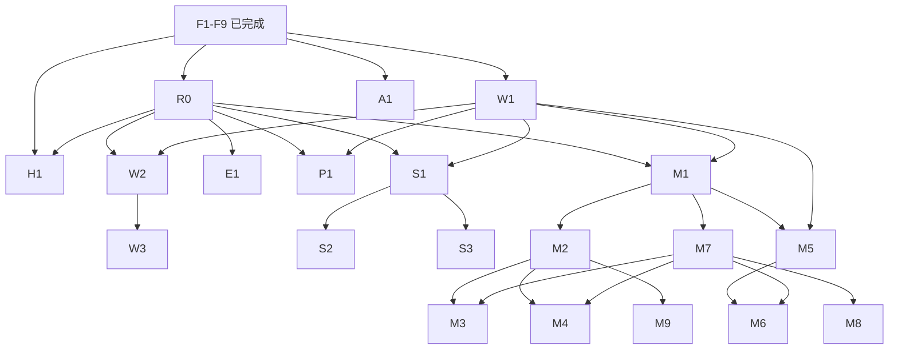

# ORI Feature Task Graph

本文件是 F10 的执行票据入口。基线为已审核的 F1–F9 与当前 Repository；本轮没有实现任何 Feature。任务 ID 表示交付顺序与验收边界，不代表新增目录、全局 abstraction 或外部操作授权。

## 基线与事实边界

- `app/_shell/routes.ts` 是导航映射唯一 owner：`/mine`、`/points`、`/stake`、`/explore`、`/about`；`/` redirect 到 `/mine`。五个页面现在都只有标题。
- F9 Header 的 Connect 仍禁用，价格没有接入；已有 Privy/Wagmi/Viem Provider 不等于已有钱包交互 Feature。
- F6 提供 ORI form POST transport、错误边界和 Token price mapper；没有各 Feature 的 Query hooks。ORI 不需要后端登录、App ID 或签名。`open-questions.md` 的 Q-13 仍保留旧鉴权提问，但不得据此重新实现 Backend Auth；已确认的 F6 事实见 [api.md](./api.md#authentication--signing)。本票据不擅自清理问题清单。
- F7 是懒连接、引用计数、去重、重连 resync 的基础能力；事件 payload 仍为 unknown，Development 502 与真实事件未观察到的 Q-47 没有解决。本轮未重新探测服务。
- 开发目标为 BSC 97；生产 56 的 App、RPC、后端与 WS 配置仍有独立发布 Gate。不可把生产未知项泛化为所有开发工作的阻塞，也不可将开发通过当作生产通过。
- 视觉依据是 `ORI-AI测试`，完整 node 索引见 [figma-inventory.md](./figma-inventory.md)。下面引用 node 是实现时重新读取 Figma MCP 的入口，不是本轮新读取的设计数据。BURY、SOL 占位、历史 live UI 不提供当前视觉标准。
- Q-03 品牌与代币资产、Q-05 字体授权继续保留。沿用已审核 F8 system fallback 与 F9 可替换单色 Header，不自行下载字体或选择最终品牌。需要新的 Token/BNB/起源资产时先过资产 Gate。

## 状态定义与总览

- **READY**：限定 Scope 的前置实现已存在，没有必须先回答的产品未知项；仍需正常评审与该票据的人工 Gate。不是自动授权登录、交易或发布。
- **PARTIALLY BLOCKED**：有明确可独立验收的准备工作，但完整 Feature 的一部分还受问题或前置票据阻塞。只能交付表中列出的安全子集，不把其余内容补成默认值。
- **BLOCKED**：核心行为/数据/交易契约或必要前置尚未完成，不启动正式端到端实现；先完成指定解锁动作。

状态是本次仓库快照；执行任何票据前重读问题清单与实际代码，再更新状态。

| ID | Slice | Status | 现在可做 / 完成前必须解锁 |
| --- | --- | --- | --- |
| R0 | 只读数据与合约证据核对（支撑票据） | READY | 可核对并输出逐项通过/阻塞矩阵；不保证一次核对就能关闭 Q-10/Q-11 |
| W1 | Development 钱包连接与 identity | READY | 下一张 Feature Ticket；不依赖余额、Sheet 或交易规则 |
| A1 | About accordion 与正式内容 | PARTIALLY BLOCKED | 可做本地视觉/交互子集；Q-41 正文审定前不能完成正式内容 |
| W2 | Wallet Sheet：地址、复制、断开、余额 | PARTIALLY BLOCKED | W1；Q-21 PC、Q-22 余额语义、Q-03 资产与必要状态反馈 |
| W3 | Wallet export / receive | BLOCKED | W2、Q-22；不能把外部钱包解释成可导出私钥 |
| H1 | Header ORI price | PARTIALLY BLOCKED | 已有 transport/mapper；Q-23 价格身份/来源与 Q-11 字段语义待确认 |
| E1 | Explore read/UI | PARTIALLY BLOCKED | 可核对 DTO 与现有设计；Q-27 范围、Q-11 运行差异和状态设计未锁定 |
| P1 | Points read/UI | BLOCKED | Q-01、Q-20、Q-11 `points/user` 500；不能先写积分公式 |
| S1 | Stake read/UI | PARTIALLY BLOCKED | R0/W1；Summary 与读取可拆出，Q-26 范围、Q-24 提示、资产/状态仍未齐 |
| S2 | Stake deposit / withdraw | BLOCKED | S1/W1；Q-10、Q-12、金额/allowance/完成契约与安全 Gate |
| S3 | Stake yield / claim-and-deposit | BLOCKED | S1/W1；先确认 Q-26，再决定是否存在该票据的正式 Scope |
| M1 | Mine read models / owner Queries | PARTIALLY BLOCKED | 可做数据契约核对；Q-10、Q-11、参与者数据源/单位/身份缺口未消除 |
| M2 | Mine read-only UI / selection | PARTIALLY BLOCKED | M1；Q-02、Q-18、Q-19、Q-31 与异常状态待确认 |
| M3 | Mine Manual transaction | BLOCKED | W1/M1/M2/M7；Q-12、Q-16、Q-17、Q-43 |
| M4 | Mine Auto mining start / stop | BLOCKED | W1/M1/M2/M7；Q-15、Q-12、Q-17、Q-43 与执行器联调 |
| M5 | Mine Rewards read/UI | PARTIALLY BLOCKED | W1/M1；Q-10、Q-25、Q-42 与资产/状态待确认 |
| M6 | Mine Rewards claim | BLOCKED | W1/M5/M7；Q-12、Q-25、Q-42 与完成/领取安全 Gate |
| M7 | Mine polling / freshness | PARTIALLY BLOCKED | M1 提供 Query owner 后可以独立完成；不等待 Q-47 或交易实现 |
| M8 | Mine realtime invalidation | BLOCKED | M1/M7；Q-47 服务恢复、真实 payload、重连 smoke |
| M9 | Mine round-result animation | BLOCKED | M2、可信开奖结果；Q-36、开奖与 intermission 衔接，不能直接信任旧 WS 字段 |

## Dependency Graph

箭头是交付依赖，不是允许 Feature-to-Feature import。`app` 组合 Feature；共享业务事实由真正成立的 Domain 持有，通过 Public API/显式 props 使用。不得仅按本图预建 `domains/round`、`features/*` 或 Shared UI。

R0 的对应证据必须通过才允许下游读取；图中的边不代表 R0 仅产出一份“仍未知”报告就自动解锁。M1 的公开 round 查询可先于 W1 实现，账户查询/完整验收需要 W1。M9 可以在 R0/M1 已确认的链上/轮询结果上工作，**不强依赖 M8**；若要用 WS 必须等待 M8 并重新读取 canonical 数据。Stake 与 Manual/Auto 彼此不是强依赖；先完成 Stake 仅是风险递进建议。Realtime 不依赖任一写交易成功。

## 通用执行与验收约束

所有票据均继承以下内容，表内 QA 再列出专项检查：

1. 开始时读 AGENTS、对应全局规范、Project facts、当前 owner 代码和当前 scripts。没有明确 Scope/Gate 的 Unknown 保持 Unknown；部分准备完成不等于 Feature COMPLETE。
2. 业务 API/合约 read 的 server state 在 TanStack Query；Query identity 含实际影响结果的 chain/account/contract/round/page/filter 等维度。账户、链和轮次变化时取消或隔离旧请求，不展示前一个身份的数据；地址按 EVM 语义比较。
3. Privy/Wagmi 持有钱包事实；不复制到 Zustand。金额/原始整数用 string/bigint，按真实 decimals/单位转换。不能用 `parseFloat`、浮点乘除或不安全 JSON number ID 做资金计算与去重。
4. API 必须经现有 ORI transport 和 DTO boundary；错误不泄露 backend body/trace。Contract/runtime mismatch 分字段记录，不悄悄任选一个版本。测试 fixture 可以描述已知输入，不能进入生产数据路径或冒充真实余额/价格。
5. 每个会改变运行行为的票据至少运行当前 `env:check`、typecheck、lint、format:check、test、build、`git diff --check`，并完成相应浏览器/真实环境验证；具体矩阵遵守 `docs/qa.md`。不写纯 CSS snapshot，不为每个静态节点加形式测试。
6. UI 验证覆盖 375px、常见手机宽度、PC 500px 居中；检查键盘、focus、长地址/长数字、内容滚动与 safe-area。Q-05 未解决时沿用授权的 fallback；Q-30 未解决时不扩建 locale routing 或自行决定新默认语言，正式 en/zh 资源与产品审定单独过 Gate。
7. 每个写流程在实现前定义：simulation、签名/拒签、广播、receipt/revert、replacement/cancel、超时、后端 reconciliation、完成后的 owner invalidation。txHash 不是业务成功；捕获并冻结 account/chain/contract/round/operation 上下文，切换上下文不能把旧交易结果归到新账户。
8. 模拟/单元测试不授权真实交易。真实测试必须有用户针对该类操作与目标环境的明确授权；确认 BSC 97、测试合约、测试账户、额度与收款地址。不得顺手调用 `resetRound`、checkpoint、执行器、approve 或 transfer 作为 smoke。生产写与 deploy 均另行授权。

## Feature Tickets

### W1 — Development Wallet connection / identity

| Field | Ticket |
| --- | --- |
| Goal | 接入已存在的 F5 wallet runtime，使 F9 Header Connect 能启动 SDK 钱包连接，并显示当前外部钱包身份；不把完整 Wallet 混成一票 |
| Route | 全局 Header，所有现有主路由；不新增 `/wallet` |
| Owner / Dependencies | `features/wallet` 的最小连接/身份边界，由 `app/_shell` 组合；依赖 F5/F9，不重建 Provider/connector |
| Source of Truth | requirements C-04/C-08；web3.md Wallet model / F5；当前 capability、Privy config、providers |
| API dependencies | 无；不做 Backend Auth、不发送 App ID/签名 |
| Web3 dependencies | Privy ready/authenticated/wallet 与 Wagmi account/chain 的真实状态；Registry target 97；本票据无余额/合约 read/write |
| Realtime dependencies | 无 |
| UI/Figma dependencies | Header `2003:190`、`2003:990`、钱包入口 `2003:999`；仅重读并适配这些节点；SDK 自身 modal 不自建皮肤 |
| Open Questions / Blockers | Development Scope READY；Q-04 Production 与 Origins 不在本票据内。使用仓库已确认的 localhost:3000 或 :5199，不默认 :5173 被授权；若该连接仍失败，先报告 auth/origin 证据，不能修改外部配置绕过 |
| Acceptance Criteria | capability 不可用时不调用未挂载 Provider 的 hooks；未 ready 时不误启动登录；取消登录可重试；刷新与账户/链变化显示真实身份，不保存地址副本。连接后先显示只读身份状态，完整地址按钮/Sheet 行为交 W2，不添加无效 click handler。SDK disconnect 能力通过独立测试验证，产品断开入口由 W2 承载；通过 G-W |
| QA | 通用 QA；mock 覆盖 capability/ready/cancel/account/chain 切换；人工通过已授权钱包在确认的 Dev Origin 连接/刷新/断开；不做交易或资金签名。若 SDK 登录确需消息签名，先核对官方 SDK 流程和消息用途，由用户确认钱包提示，不自动签名 |
| Non-goals | Sheet、复制反馈、余额、导出/接收、网络切换 UX、资产转移、Production Privy 配置、通用钱包巨型 store |

### A1 — About accordion / approved content

| Field | Ticket |
| --- | --- |
| Goal | 用现有 App Shell 验证长正文和 accordion；正式内容来自 ORI 而非 Figma 的 Solana 占位文案 |
| Route | `/about` |
| Owner / Dependencies | About 页面局部组件与内容资源；依赖 F8/F9，无需等待 Wallet |
| Source of Truth | C-61/C-62/C-63、ui-behavior About；线上 About 的 en/zh 原文需在实现时读取核对并经产品审定，当前仓库不是完整 approved copy |
| API dependencies | 无；不为静态内容创建 API |
| Web3 dependencies | 无运行时调用；涉及费率/回购比例必须经 Q-41 文案核定 |
| Realtime dependencies | 无 |
| UI/Figma dependencies | `2003:2235`、`2003:2359`，行 `2003:2245` 等；真实箭头资产、14px 正文/20px 标题；单项展开/默认首项是 I-32 推断，验收时由 G-V 确认 |
| Open Questions / Blockers | PARTIALLY BLOCKED：可先做隔离的本地 accordion 视觉/键盘子集；正式正文受 Q-41、en/zh copy 与 Q-30 发布语言策略阻塞。不得为了先上线而自行删掉争议段落或改费率 |
| Acceptance Criteria | 产品签收 en/zh 内容与链接，映射正确 sections；可键盘展开、aria-expanded/controls 正确，长正文不被底栏遮挡；G-P/G-V 通过后才替换正式路由占位。隔离 fixture 不留 debug route，不以视觉子集宣称整票完成 |
| QA | 通用 QA；accordion 行为/焦点、长文/链接、375/500 截图；审阅文案与 source 对照表 |
| Non-goals | 根据旧 About 复刻视觉、链上费率仪表盘、CMS、全站语言切换、虚构正式文案 |

### W2 — Wallet Sheet core

| Field | Ticket |
| --- | --- |
| Goal | Header 地址入口打开 Sheet，展示确认的余额资产、复制地址与断开连接 |
| Route | 全局 overlay，无新 Route |
| Owner / Dependencies | `features/wallet`；W1；余额涉及的 R0 证据通过。accessible primitive 新增 dependency 如有必要须另按 tech-stack 评估 |
| Source of Truth | C-22、I-10/I-11、web3.md Wallet model、assets.md |
| API dependencies | 默认无；不能把 `activity/origin_info.my_wallet` 自动当作外部钱包余额 |
| Web3 dependencies | 对经确认的资产使用当前地址/目标链的 native/ERC20 balance read；decimals 必须核对，Query 含 account/chain/token |
| Realtime dependencies | 无；不能借 Mine 事件刷新所有钱包数据 |
| UI/Figma dependencies | `2003:2487`、`2003:2490`、地址/关闭/复制/断开节点；G-V 确认 PC 呈现、focus trap/restore、ESC/遮罩与 safe-area |
| Open Questions / Blockers | PARTIALLY BLOCKED：地址复制/断开控制逻辑可测试；完整 Sheet 等 Q-21、Q-22 余额口径、Q-03 资产及复制/余额异常反馈设计；不得自己把 PC 改成居中 Dialog |
| Acceptance Criteria | G-P/G-W/G-V 通过；地址完整复制、展示缩短，断开清理身份关联 UI；账户/链切换不显示旧余额；读失败与真实 0 分开，复制失败可发现；不读取私钥 |
| QA | 通用 QA；clipboard 成功/拒绝、focus/ESC/滚动锁定恢复、断开/切换、余额错误与精度 |
| Non-goals | W3、任意收款/转账、私钥导出、交易历史系统 |

### W3 — Export / Receive decision and implementation

| Field | Ticket |
| --- | --- |
| Goal | 仅在产品明确语义后实现 Wallet 剩余操作；若产品决定不支持，记录决定并取消本票据 |
| Route | W2 Sheet 内 |
| Owner / Dependencies | Wallet；W2、Q-22 先过 G-P/G-W |
| Source of Truth | Q-22、外部钱包事实、产品确认的操作/目标资产/网络 |
| API dependencies | 当前无确认端点；需要新端点须先锁 Contract |
| Web3 dependencies | 当前没有获准 write；receive 若仅展示地址也不能演变成发送资产。外部钱包不提供应用可导出的私钥 |
| Realtime dependencies | 无 |
| UI/Figma dependencies | Wallet `2003:2526` 等操作位；缺少详细流程设计，确认后重读/补设计 |
| Open Questions / Blockers | BLOCKED：export 的对象、receive 的操作与余额资产均未知 |
| Acceptance Criteria | 语义、支持钱包、隐私/失败路径经人工签收；实现与确认操作完全对应，不接触或传递私钥；若产生交易另过 G-T |
| QA | 通用 QA 加批准流程的专项用例；真实资金操作不作为普通 smoke |
| Non-goals | 从按钮名称推断 transfer、创建 embedded wallet 或拼接未确认的二维码/支付协议 |

### H1 — Header price read/UI

| Field | Ticket |
| --- | --- |
| Goal | 给 F9 价格位接入确认的 ORI 价格，移除无数据时的歧义，保持 Header 尺寸 |
| Route | 全局 Header |
| Owner / Dependencies | `app/_shell` 组合、现有 `domains/token` read/model；F6/F9；R0 对应端点核对 |
| Source of Truth | C-21、Q-23、api.md Numeric fields 与现有 asset-price mapper |
| API dependencies | 候选 `query/chain_asset_config`；不能未经确认改用 `activity/origin_info`。symbol/address/isInner 匹配语义先锁定 |
| Web3 dependencies | 使用 Registry 的 ORI 资产身份；本票据不补 BSC 97 WBNB 地址，不把缺失 BNB 美元价变成 0 |
| Realtime dependencies | 无；刷新策略由 price Query owner 定义 |
| UI/Figma dependencies | Header `2003:195` 价格位；空/加载/失败显示需 G-V |
| Open Questions / Blockers | PARTIALLY BLOCKED：mapper 已存在；Q-23、Q-11 price 类型/单位/inner 语义与异常反馈未确认 |
| Acceptance Criteria | G-D/G-P/G-V 通过；只显示目标资产的真实价格，十进制精度安全；无数据不显示设计示例 $268.32，也不挤压连接入口 |
| QA | 通用 QA；资产/address 匹配、多行/缺价、number/string DTO、长价格布局 |
| Non-goals | 通用行情系统、实时价格 WS、Stake APR 推导 |

### E1 — Explore read/UI

| Field | Ticket |
| --- | --- |
| Goal | 实现经确认范围的统计、Mining/Motherlodes/Buybacks 分页与表格 |
| Route | `/explore` |
| Owner / Dependencies | `features/explore`；F6/F9；R0 的对应后端证据通过；公开数据不要求钱包登录 |
| Source of Truth | C-60、Q-27、api-reference 正式 Contract 与 api.md Differences；旧调用只作证据 |
| API dependencies | `explore`、`reset_event/list`（motherlode filter）、`bury_event/list` / `activity/bury_point_events` 的选用与 type 必须由 scope 对照锁定；page/page_size、list/total、时间/金额单位及稳定行 identity 明确 |
| Web3 dependencies | 无默认合约调用；链维度用于隔离数据集，链上 explorer URL 来自 Registry |
| Realtime dependencies | 无必需订阅；不要复制 Mine 事件接线 |
| UI/Figma dependencies | `2003:2534`、`2003:2659` 等统计卡、`2003:2883` 等分页；375px 表格局部滚动 |
| Open Questions / Blockers | PARTIALLY BLOCKED：可核对 DTO/单位与表结构；Q-27 旧多标签是否保留、Q-11 缺 circulating_supply/number-string 差异、不安全 number ID、加载/空/错误与资产待定；不能先决定隐藏字段 |
| Acceptance Criteria | G-P/G-D/G-V 后完成；不虚构缺失统计；分页/filter Query identity 完整；大整数行 ID 不用已丢精度值；表格滚动不造成整页 overflow |
| QA | 通用 QA；DTO 缺字段/超大 ID、分页边界与过滤、错误/无记录、375/500 长表 |
| Non-goals | 起源/ORI 游戏页面、swap、交易、用相似 Table 提前造通用系统 |

### P1 — Points read/UI

| Field | Ticket |
| --- | --- |
| Goal | 显示真实用户积分与记录，规则与产品签收版本一致 |
| Route | `/points` |
| Owner / Dependencies | `features/points`；W1、R0、F9；钱包地址仅是请求参数，不是 Backend session |
| Source of Truth | Q-01/Q-20、正式 points Contract；`2003:2101` 仅提供视觉 |
| API dependencies | `points/list`（miner/page/page_size → list/total/user_points）、`points/user`（miner → total_points）；后者 Development 500 需后端修复并核对一致性 |
| Web3 dependencies | W1 身份；无合约写，不在客户端自行从 BNB/美元交易额推积分 |
| Realtime dependencies | 当前无已确认的积分事件；刷新策略在端点确认后定义 |
| UI/Figma dependencies | `2003:2113`、`2003:2117`、Records；规则副标题、无钱包/错误/空状态须签收 |
| Open Questions / Blockers | BLOCKED：Q-20 两种积分规则冲突、Q-01 起源关系、Q-11 500/单位/一致性、Q-03 资产 |
| Acceptance Criteria | G-P/G-D/G-V；规则/精度/时间口径已锁定，真实 API 返回可验证，账户切换清除旧积分，未连接不冒充 0 积分 |
| QA | 通用 QA；500 业务错误、列表/总分一致性、分页、地址大小写、身份切换 |
| Non-goals | 假积分、本地积分计算、未确认的起源入口与 Token 兑换 |

### S1 — Stake read/UI

| Field | Ticket |
| --- | --- |
| Goal | 建立只读 Summary、账户质押数据与 Deposit/Withdraw 表单展示，写入口保持不可执行 |
| Route | `/stake`；Withdraw 是页内状态，无新 Route |
| Owner / Dependencies | `features/stake`；W1/F9；R0 的 ABI/单位/端点证据；公共 Summary 可先于账户读取 |
| Source of Truth | C-50–C-53、web3.md Stake、api-reference summary、Q-26 |
| API dependencies | `summary` → staking_annual_yield；TVL/total deposit 的来源、价格与显示单位必须逐项核对，不能从 APR 推造其它字段 |
| Web3 dependencies | Registry OreProtocol `getStakeInfo` / `getTreasuryState`、ORI `decimals`/balance；不 approve、不 deposit/withdraw |
| Realtime dependencies | 无必需订阅；账户/链变化与基础 polling 由 Stake Query owner 负责 |
| UI/Figma dependencies | `2003:1949`、`2003:1961`、`2003:2078`；AmountInput/percentage 的共享只在真实需求出现时评估 |
| Open Questions / Blockers | PARTIALLY BLOCKED：可先核对公共读与 DTO；Q-10、Q-26 yield 范围、Q-24 Info 内容/行为、Q-16 percentage、Q-03 资产与状态设计需确认 |
| Acceptance Criteria | G-D/G-P/G-V；显示真实 ORI/decimals，百分比 bigint 安全；未知收益字段不补零；表单不产生写调用；账户/链切换不串数据 |
| QA | 通用 QA；余额/单位/精度、Summary DTO、Tab 键盘语义、断网/身份切换、长数值 |
| Non-goals | 质押资金操作、yield 领取、收益率估算算法或跨 Feature Query deep import |

### S2 — Stake deposit / withdraw

| Field | Ticket |
| --- | --- |
| Goal | 在 S1 基础上完成独立可审查的 ORI 存入与取出流程 |
| Route | `/stake` |
| Owner / Dependencies | Stake workflow；S1/W1；相关 R0 证据与 G-T 先通过 |
| Source of Truth | C-50/C-51、Contract Registry ABI、docs/web3.md transaction contract |
| API dependencies | 通常无写 API；确认后刷新 S1 owner Queries，若需后端索引必须锁定 reconciliation endpoint |
| Web3 dependencies | ORI allowance / approve(OreProtocol) → approval receipt → depositStake；withdrawStake(amount,to)。先 simulation、上下文冻结与资产/收款地址校验 |
| Realtime dependencies | 无；不得等待 Mine WS 才刷新账户数据 |
| UI/Figma dependencies | S1 表单加签名/pending/reverted/cancel/timeout/完成状态；Q-12 无设计时不得自行造全局 toast 系统 |
| Open Questions / Blockers | BLOCKED：S1、Q-10、Q-12、存取上下限与 allowance 授权额度策略/确认次数等完成契约；不默认 unlimited approval |
| Acceptance Criteria | 每个操作明确状态、确认阈值与失败语义；approve 后重读 allowance，拒签/失败不进入 deposit；切链/切账户使未签操作失效，旧 receipt 不更新新账户；G-T/G-W/G-V |
| QA | 通用 QA；模拟所有失败/替换/超时与 approval 分阶段路径；真实 BSC 97 approve/deposit/withdraw 仅在明确授权后验证并报告余额变化 |
| Non-goals | yield、自动复投、主网测试、一次批准全部未来额度 |

### S3 — Stake yield / claim-and-deposit

| Field | Ticket |
| --- | --- |
| Goal | 先确定新版是否支持质押收益操作；批准后按每种资金流程再单独验收 |
| Route | `/stake` |
| Owner / Dependencies | Stake；S1/W1，复存若需要 deposit 则依赖 S2；Q-26/G-P 先通过 |
| Source of Truth | C-53、Q-26、已核对 ABI；不能从旧 Claim and deposit 文案推断原子流程 |
| API dependencies | 复用已确认的 Stake read/reconciliation；无新假端点 |
| Web3 dependencies | 候选 claimStakeYield(to)；claim-and-deposit 的调用组合、失败补偿、是否需多笔交易尚未确认 |
| Realtime dependencies | 无 |
| UI/Figma dependencies | 新版没有对应完整 UI，需设计补充及 Q-12 状态 |
| Open Questions / Blockers | BLOCKED：Q-26、Q-10、Q-12；先锁范围再决定拆成 claim 与复存子票据 |
| Acceptance Criteria | 人工确认保留/取消；保留时每笔资金调用及完成契约清楚，G-T/G-V 通过；不存在“第一笔成功即整体成功” |
| QA | 通用 QA；多步中断、拒签/部分成功、上下文切换；真实交易另授权 |
| Non-goals | 预建自动复投机器人、无确认的批处理交易 |

### M1 — Mine read models / owner Queries

| Field | Ticket |
| --- | --- |
| Goal | 为 round、square、miner、当前账户部署建立字段级数据来源与稳定 Query owner，先解决可见数据可信度 |
| Route | `/mine` 的数据边界；本票据不改交易入口 |
| Owner / Dependencies | Mining read owner；F6、Registry/F5、R0；账户读接 W1。是否成立 `domains/round` 按真正复用决定，不按票据预创建 |
| Source of Truth | C-30/C-43/C-45/C-49、api.md、web3.md View methods、正式 API Contract |
| API dependencies | latest/events、reset_event/round、两个名称疑似互换的 round endpoints；旧 `round` 不在 Contract。参与人数/列表/排序/分页及 identity 尚需补齐；不能宣称 View squareAmounts 就包含人数/名单 |
| Web3 dependencies | 已验证 View getCurrentRoundInfo/getCurrentRoundSquareStats/getCurrentRoundSquares/getMinerSquares，必要时 board/getTreasuryState；确定 roundId、block 时间与 chain head 语义 |
| Realtime dependencies | 无；Query 不依赖 WS 才可工作 |
| UI/Figma dependencies | `2003:485` 等 Metrics、`2003:508` Miners 的字段需求；不把 Figma 示例数字做默认数据 |
| Open Questions / Blockers | PARTIALLY BLOCKED：可先完成逐字段来源表与 mapper 测试；Q-10、Q-11 当前 round API 缺口/端点对调、单位/大整数 ID、参与者数据不足必须过 G-D。采用链上替代须核对覆盖字段并经评审，不能默认为等价 |
| Acceptance Criteria | 每个字段有 canonical 来源、单位、identity 和冲突/缺失处理；public/account Queries 分离、round 切换原子隔离旧结果；缺失字段不补零；G-D 签收后才宣布 read model 完成 |
| QA | 通用 QA；DTO/精度/地址大小写/25 项长度、旧 round 响应迟到、账户/链切换、API/链上差异用例 |
| Non-goals | 投注/领奖、巨型 roundStore、把全部旧接口搬进 Shared、擅自选择后端替代 endpoint |

### M2 — Mine read-only UI / selection

| Field | Ticket |
| --- | --- |
| Goal | 实现 Metrics、5×5 BlockGrid、Miners 与只读状态；选择是局部 UI，资金动作留给后续票据 |
| Route | `/mine` |
| Owner / Dependencies | Mining UI；M1、F8/F9；我的部署需 W1 |
| Source of Truth | C-43/C-45/C-49、ui-behavior Mine；金额显示仅消费 M1 model |
| API dependencies | 仅 M1 Queries，无重复请求层 |
| Web3 dependencies | 仅 M1 reads；不启动 simulation/write |
| Realtime dependencies | 初期不直接订阅；M7 负责新鲜度，M8 后续接入 |
| UI/Figma dependencies | `2003:182`、`2003:629`、`2003:1009`、`2003:1038`；状态/图标精确重读，真实 BNB/ORI/起源资产 |
| Open Questions / Blockers | PARTIALLY BLOCKED：可隔离核对无争议格子/布局；完整页等 M1、Q-02 ORI 游戏范围、Q-18 部署颜色、Q-19 全选/可选择时机、Q-31 母矿双资产和 loading/error/empty 视觉；Q-01 未解决不能删掉起源业务概念 |
| Acceptance Criteria | G-P/G-D/G-V；25 格状态与数据一致，选择不写链、不跨新 round 遗留，选中与部署状态可区分；等候/错误不是零余额，长 Miners 列表局部/页面滚动正确 |
| QA | 通用 QA；mask/选择规则测试、所有已确认状态 fixture、账户/round 切换、375/500 对照 |
| Non-goals | Manual/Auto 表单资金动作、完整动画、设计外 trade-to-mine 标签或起源 swap |

### M3 — Mine Manual transaction

| Field | Ticket |
| --- | --- |
| Goal | 一轮多格同金额的 Manual 部署，完成前置校验与确认后的数据对账 |
| Route | `/mine` Manual 面板 |
| Owner / Dependencies | Mining Manual workflow；W1/M1/M2/M7，R0 对应协议证据；不依赖 Stake |
| Source of Truth | C-31/C-32/C-34/C-46、deployManual ABI、docs/web3.md |
| API dependencies | M1 canonical round / 我的部署；后端索引是否属于完成契约先明确，不以缺失旧 `/round` 端点当完成条件 |
| Web3 dependencies | deployManual(mask,amountPerSquare)，value 精确等于 amountPerSquare × selected count；无需 ERC20 approve；读 canDeploy/当前部署/automation conflict，处理 checkpoint 错误 |
| Realtime dependencies | 不强依赖 M8；确认后明确 invalidation 与 M7 polling 对账 |
| UI/Figma dependencies | `2003:1715` 及 4 个 Manual 状态；Q-12 待补交易状态 |
| Open Questions / Blockers | BLOCKED：前置票据，Q-12、Q-16 快捷值、Q-17 min/max/decimals/gas 留存、Q-43 checkpoint owner；不能自行发送 checkpoint 修复失败 |
| Acceptance Criteria | G-P/G-T/G-V；25 位 mask 合法、总额 bigint、同轮重复/Auto 冲突 fail closed；拒签与链上 revert 不混淆；以批准的 receipt/reconciliation 标准完成并刷新正确账户/轮次 |
| QA | 通用 QA；全部/单格/非法 mask、精度/余额边界、round 在签名前后切换、重复点击、replacement/timeout；真实部署仅 BSC 97 单独授权 |
| Non-goals | Auto、Rewards、前端代替 bot 结算、设置无限重试或主网 smoke |

### M4 — Mine Auto mining start / stop

| Field | Ticket |
| --- | --- |
| Goal | 在明确预付公式与执行器事实后实现多轮自动部署、运行状态和停止退款 |
| Route | `/mine` Auto 与 Autominer 状态，无新 Route |
| Owner / Dependencies | Mining Automation workflow；W1/M1/M2/M7；不把 Manual 成功当作技术前置，建议在 M3 审核后推进以降低风险 |
| Source of Truth | C-31/C-33/C-34/C-47/C-48、registerAutomation/getAutomation/stopAutomation、正式 automation Contract |
| API dependencies | automation/user 的 user 参数与响应字段/单位；链上 getAutomation 与后端不一致时的 canonical/索引延迟先锁定 |
| Web3 dependencies | registerAutomation 的 owner/balance/mask/amountPerSquare/randomizeMask/active/botFee 与 msg.value；stopAutomation(to) 收款地址与退款验收；执行器由后端/协议 owner 提供 |
| Realtime dependencies | M7 首先 polling；M8 后续仅 invalidation，不能用事件推算余额/剩余轮数 |
| UI/Figma dependencies | `2003:1832`、`2003:1890`、`2003:1667`、运行中 `2003:1413`；费用/最大轮数状态需补齐 |
| Open Questions / Blockers | BLOCKED：Q-15 总额/每格/轮次与 botFee/executorFee、Q-12、Q-17、Q-43、执行器可用性与余额退回证明；不得硬编码猜测公式 |
| Acceptance Criteria | G-P/G-T/G-V；精确预付拆分、随机/指定 mask 一致、Manual 互斥；start receipt 不等于已执行下一轮；stop 后按批准的链上状态/退款对账，不依据旧 UI 直接显示成功 |
| QA | 通用 QA；轮数/费用/余额/随机位图、执行器延迟/缺席、停止失败与退款地址、账户/链/round 切换；start/stop 真实调用分项授权 |
| Non-goals | 自建 executeAutomation bot、后台常驻任务、从前端执行 resetRound |

### M5 — Mine Rewards read/UI

| Field | Ticket |
| --- | --- |
| Goal | 显示当前账户 BNB、直接 ORI、精炼 ORI 的真实可领取事实，先完成只读卡片 |
| Route | `/mine` Rewards 区 |
| Owner / Dependencies | Mining Rewards read/UI；W1/M1，R0 对应 ABI；不要求 M3/M4 已发出交易（可以有历史账户数据） |
| Source of Truth | C-40–C-42、getUserRewards 返回字段与 Q-25/Q-42 |
| API dependencies | 非必需；若起源奖励需额外 API/AssetManager，先明确边界与 Q-01，不能塞入同一 Rewards model |
| Web3 dependencies | getUserRewards(miner)、ORI decimals；不能把 ethAmount 命名成 ETH 或把 ORI 显示成 ORE/BURY |
| Realtime dependencies | M7 刷新已有 owner Query；M8 可后接 |
| UI/Figma dependencies | `2003:1683` 等 Rewards 卡；是否有奖励才显示是 I-30，需要人工确认 |
| Open Questions / Blockers | PARTIALLY BLOCKED：mapper 与 read 可核对；正式展示等 Q-10、Q-25 名称、Q-42 时限/过期语义、Q-03 资产与必要状态 |
| Acceptance Criteria | G-D/G-P/G-V；金额独立建模、无奖励和读取失败分开；未知到期时间不推造 countdown；本票据 Claim 不可执行 |
| QA | 通用 QA；三类金额/零/过期/读取失败、地址切换、长数值与卡片显示条件 |
| Non-goals | M6、AssetManager 的未确认 claim/claim_bnb、起源奖励资金流程 |

### M6 — Mine Rewards claim

| Field | Ticket |
| --- | --- |
| Goal | 独立完成 claimAll 与仅 BNB claimEth 的资金流程 |
| Route | `/mine` Rewards 区 |
| Owner / Dependencies | Mining claim workflow；W1/M5/M7，已核对的协议证据 |
| Source of Truth | C-40/C-41/C-42、claimAll(to)/claimEth(to)、对应错误与全局 transaction contract |
| API dependencies | 明确是否有业务索引完成条件；无此依赖时不可发明 claim API |
| Web3 dependencies | 明确 to、claimFeeBps/税语义、可领取时限；simulation、receipt 与领取后 reward/balance reads；无需擅自 approve |
| Realtime dependencies | M8 非前置；receipt 后主动刷新 M5/Wallet 的真实受影响 owner，不广播全站 invalidation |
| UI/Figma dependencies | Rewards Claim / Claim only 文案与 Q-12 交易状态补充 |
| Open Questions / Blockers | BLOCKED：M5、Q-12、Q-25、Q-42；若出现 checkpoint 需要走 Q-43 人工决定，不自动追加 write |
| Acceptance Criteria | G-P/G-T/G-V；正确领取类别和收款地址，NothingToClaim/ClaimWindowPassed 明确；receipt 与可见余额对账按完成契约区分，旧账户结果不污染新上下文 |
| QA | 通用 QA；全领/仅 BNB、无奖励/过期/拒签/revert/replacement、税与精度；真实 claim 操作另行授权 |
| Non-goals | 起源 claim、expired reward sweep、替他人领取、质押收益领取 |

### M7 — Mine polling / freshness

| Field | Ticket |
| --- | --- |
| Goal | 使 Mine 在 WS 不可用时也能持续获得可信 read state；新鲜度规则跟数据 owner 对齐 |
| Route | `/mine` 生命周期；不在全局 Header 常驻轮询 |
| Owner / Dependencies | M1 Query owner；如 M5/Automation owner 已存在，分别按 Public API 接入；不要求写交易或 M8 |
| Source of Truth | api.md polling 与 TanStack Query integration、M1 字段来源；旧 1s/3s/4s/10s 只是历史证据 |
| API dependencies | 对已锁定端点定义间隔、后台/聚焦/重连、失败退避及取消策略；未知 round 端点不得进入调度 |
| Web3 dependencies | M1 合约读 Query；明确 RPC 负载与 round/账户/链变化的启停条件 |
| Realtime dependencies | 不依赖连接成功；disabled/unavailable 时 polling 不停止 |
| UI/Figma dependencies | 无新增组件；stale/error 对应已批准的 UI 状态 |
| Open Questions / Blockers | PARTIALLY BLOCKED：M1 未交付前无法定义所有 keys/来源；后端/协议 owner 须签收频率、限流、时间语义。Q-47 不阻塞本票据独立完成 |
| Acceptance Criteria | G-D；逐数据 owner 写明 freshness budget 与执行策略，离页无泄漏，聚焦/重连刷新，旧请求不覆盖新 round；不复制全局 timer/server state |
| QA | 通用 QA；fake timers/请求计数验证启停与退避、后台恢复、离页、账户/链/round 切换；真实只读压力以批准的频率验证 |
| Non-goals | 把旧轮询间隔固化为默认、WS 实现、定时后台执行交易 |

### M8 — Mine realtime invalidation

| Field | Ticket |
| --- | --- |
| Goal | 在 M7 之上给轮次开始/开奖增加及时刷新信号，并验证断线补偿 |
| Route | `/mine`；最后一个消费者离开即释放 |
| Owner / Dependencies | Mining/实际 round Query owner；M1/M7 与 F7，不重建 Pusher client |
| Source of Truth | api.md Realtime、ori-realtime-events.ts、真实 backend payload Contract 与 smoke |
| API dependencies | 事件后重新请求 M1/已存在的 Automation/Rewards owner Queries；不以 payload 当 canonical server state |
| Web3 dependencies | 只 invalidate 已确认相关 read；无 write |
| Realtime dependencies | round.new_round / round.data.started；round.reset / round.data.reset；F7 event/resync；schema 确认后在事件定义 parse 边界校验 |
| UI/Figma dependencies | 无新 UI；动画另由 M9 接管，不与 transport 合并 |
| Open Questions / Blockers | BLOCKED：Q-47 Development 502、真实订阅与 payload 未观察；还需确认事件 round identity、重复/乱序、是否有轮内推送。不在未恢复时用 mock 宣布真实接入完成 |
| Acceptance Criteria | G-R；实际服务连接/两个订阅/真实样本/断线重连均有证据；event/resync 只 invalidate 受影响 keys，重复/坏 payload 不跨 round；WS 关闭时 M7 正常，离页无残留 |
| QA | 通用 QA；mock 覆盖坏消息/重复/乱序/resync/多订阅者；真实只读 smoke 独立记录结果，不能在测试中发交易制造开奖 |
| Non-goals | 去掉 polling、事件写入 Zustand/手工 patch Query、修服务器/改 WS security、部署实时基础设施 |

### M9 — Mine round-result animation

| Field | Ticket |
| --- | --- |
| Goal | 将可信 round 结果呈现为 Figma 指定结果动画，独立于网络 transport 与资金流程 |
| Route | `/mine` |
| Owner / Dependencies | Mining 本地 UI；M2 与 R0/M1 已确认的开奖结果；采用 WS 时额外依赖 M8 |
| Source of Truth | C-44、ui-behavior 结果动画；不能用名称对调的 API 或旧 data.winning_square 直接判定 |
| API dependencies | 经过验证的结果模型与 round identity；reset_event/round 等端点选用由 M1/G-D 锁定 |
| Web3 dependencies | 无新增写；链上结果来源也由 M1 抽象 |
| Realtime dependencies | 可由 polling 驱动，不强依赖 WS；事件仅促使读取结果 |
| UI/Figma dependencies | `2003:1405`–`2003:1408`；3.6s 淡出、0.15s 点亮、10s 保持，与真实 intermission 的衔接必须另确认 |
| Open Questions / Blockers | BLOCKED：M2、Q-36 reduced-motion、动画结束/新轮开始/后台恢复时的优先级和重复结果播放策略；这些未确认前不自行截断/延长合约轮次 |
| Acceptance Criteria | G-P/G-V；同 round 不重复播放，迟到结果不覆盖新轮，离页/后台能清理并恢复；reduced-motion 有批准方案；动画状态不修改账户余额或协议状态 |
| QA | 通用 QA；可控随机顺序与 fake timers 验证时序、重复/乱序、切页/切轮、reduced-motion；视觉验收不是开奖结果正确性的证明 |
| Non-goals | 决定中奖方块、客户端模拟开奖结果、以动画结束替代交易/协议完成 |

## R0 — 支撑票据：只读证据核对

| Field | Ticket |
| --- | --- |
| Goal | 按一个下游 Slice 的字段需求核对 API/ABI/部署事实，产出 PASS/未验证/阻塞矩阵与需后端/协议 owner 确认的差异；不要求一次覆盖全系统 |
| Route | 无 UI route |
| Owner / Dependencies | 文档与对应 DTO/contract owner 的调研；现有 F3–F6；READY |
| Source of Truth | Registry/原始 ABI、正式 api-reference、Development read 返回；api.md/web3.md 的旧说明只提供调查入口 |
| API dependencies | 仅核对下游列明的只读 POST 端点/字段/参数/单位/失败 envelope，不把 POST 一概当 mutation，也不调用未知操作 |
| Web3 dependencies | BSC 97 部署代码/代理实现与已验证 ABI、必要 read simulation/call、ORI decimals；记录版本 owner、校验依据与无法验证项，不能靠一次成功 call 证明整个 ABI 一致 |
| Realtime dependencies | R0 不关闭 Q-47，真实 WS 核对属于 M8/G-R |
| UI/Figma dependencies | 无；消费 Slice 的字段清单，不设计新 UI |
| Open Questions / Blockers | 可以开始核对；答案仍需 backend/protocol owner。97 WBNB 缺口仅阻塞对应美元价，不阻塞无关读取。缺失数据源时允许输出 BLOCKED，禁止虚构替代 |
| Acceptance Criteria | 逐字段列来源/单位/identity/证据/差异/owner；明确哪些下游 reads 可解锁；保持 Q-10/Q-11 未确认部分，敏感连接信息/完整 backend trace 不入文档 |
| QA | 检查采样与 Contract 对照、地址/链匹配、文档 diff/format；真实服务不可达如实报告，不冒充本轮重测成功 |
| Non-goals | contract write、发交易、修改 endpoint/key/auth、安装替代 SDK、修后端或部署、自动关闭 Unknown |

## Human Gates

| Gate | Reviewer / 必需证据 | 未通过时的边界 |
| --- | --- | --- |
| G-P Product-rule | 产品 owner：范围、单位、公式、文案、费用/时限与状态交互；回答写回 requirements 并注明来源 | 不把 Unknown 做默认值；不能发布争议文案、积分规则或 Auto 预付公式 |
| G-D Data contract | Backend + 协议 owner：字段/端点/ABI、部署实现、round/账户 identity、单位、缺失/错误、刷新负载及对账来源 | 不接未经确认端点，不把缺字段补 0；只完成核对/测试子集 |
| G-V Visual | 设计/产品 reviewer：当前 Figma 对照、375/常见手机/500 居中、键盘/安全区、缺失状态和资产；允许的临时 fallback 明示 | 不把历史稿或 Agent 自创状态当设计签收；Q-03/Q-05 未关闭前不升级最终品牌/字体 |
| G-W Wallet behavior | 人工确认 Dev Origin、连接钱包/账户/链变化/取消/断开证据；W2 还需 PC Sheet、复制与余额语义 | W1 的连接验收不自动授权 W2/W3、消息签名或资产操作；登录消息如确需签名由用户确认，生产 App/Origins 另确认 |
| G-T Transaction safety | 产品/协议 reviewer：逐流程参数、目标链/合约/收款地址、额度、simulation、receipt/reconciliation、错误/替换/超时；用户另行明确真实测试授权 | 先 mock/只读检查；不得由“实现交易”推成测试网或主网的自动资金操作授权 |
| G-R Realtime | Backend owner 恢复服务；reviewer 检查实际订阅、schema、重复/乱序/resync、断线 polling 证据 | mock 可以完成逻辑测试，不能宣称已接通真实 WS；不能关闭 M7 |
| G-L Release | 产品/运维确认 Q-01/Q-02 范围、Q-03/Q-05 资产/字体、Q-04/Q-14/Q-34 生产配置、Q-30 语言、Q-35 地区限制及相关安全事项 | 开发 Feature READY 不等于可上线；没有 deploy、生产 Secret/Account 或资金操作授权 |

## 推荐实施顺序与下一张票据

**下一张真正执行的 Feature Ticket：W1 — Development Wallet connection / identity。** F5/F9 已具备 Provider、capability 和真实 Header 入口，开发链/App 已确认；本票据不依赖资金、价格、Sheet 未决动作或 Mine API 缺口，且能验证最小 Client boundary 与 Shell 的组合。只读身份状态是 W1 的明确交付边界，不宣称完整 Wallet 已完成；G-W 未过不进入资金流程。

1. W1；同时可分批执行 R0 的只读核对与人工决策，不需要等钱包连接成功才审阅文案或公开 API。
2. Q-41/copy 审定后完成 A1，作为无资金长页面的视觉 Gate；Q-21/Q-22 核定后完成 W2。若这些 Gate 先解除，可以调整顺序，但不自动改为 READY。
3. 经对应 G-D/G-P 解锁的 E1、H1、S1；M1 → M2 与 M7。M7 不等 WS 恢复，M5 可在数据契约/身份稳定后独立推进。Points P1 只在 Q-20 与接口修复后进入队列，不能为了补齐导航提前实现。
4. 先评审 S2 的 approve/deposit/withdraw，再按独立 Gate 评审 M3、M6；M4 因预付公式与执行器依赖更强，后置。S3 先决定是否保留；所有真实交易仍逐类授权。
5. Q-47 恢复且 M1/M7 owner 明确后做 M8，不需等全部交易完成；M9 在结果来源/时序/reduced-motion 明确后执行，不与 transport 或资金流程绑定成巨票据。
6. W3、起源/ORI 游戏与生产发布均留在对应 Gate 后。Q-01/Q-02 未确认前，本图**不安排起源 swap/trade-to-mine 实现**；这不等于决定下线它们。

拆分理由：Wallet 的连接、Sheet、未定义资产操作风险不同；Stake 的读取、approve/存取与未定收益流程不同；Mine 的数据契约、只读 UI、Manual、预付 Auto、Rewards read/claim、polling、WS、动画分别有独立 owner/验收证据。先完成一张票据不自动授权下一张，也不要求通过 Feature-to-Feature import 复用。

## 本轮文档 QA 范围

仅更新规划文档、交叉链接和阶段状态，执行 `pnpm format:check`、`git diff --check` 与内容/依赖一致性检查。依 `docs/qa.md` 的 Docs 矩阵，本轮不要求 build、业务测试、外部 API/RPC/WS smoke 或浏览器视觉 QA；这些是后续实现票据的验收要求。本轮没有关闭产品 Unknown，也没有授予 commit/push/deploy 或业务实现权限。
